<div align="center">


# agentbox

**Your AI coding workspace. On your server. In your browser.**

Run Claude Code and Codex CLI on a Linux server you control.<br /> Go from a task to reviewed code with chat, terminal, files, and Git in one place.

[](https://github.com/devilcoolyue/agentbox/releases/latest) [](go.mod) [](images/agent/Dockerfile) [](LICENSE)

**English** | [简体中文](README_CN.md)

[Watch the tour](#see-it-work) · [Highlights](#highlights) · [Screenshots](#screenshots) · [Quick start](#quick-start) · [Architecture](#how-it-works) · [Documentation](#documentation)

</div>

## See it work

<a href="docs/media/agentbox-tour-en.mp4?raw=1">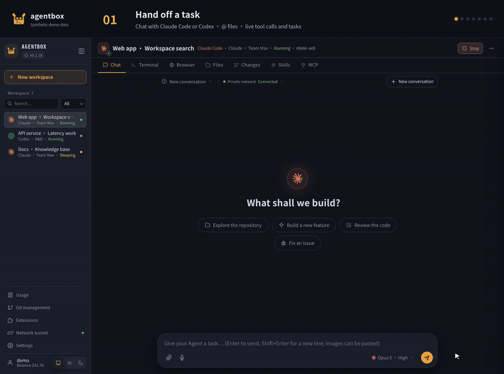</a>

<p align="center"><a href="docs/media/agentbox-tour-en.mp4?raw=1"><strong>▶ Full tour in 1920 px (MP4, 70 s)</strong></a> — adds file previews, usage records and switching between the six interface styles · <a href="#screenshots">Screenshots</a></p>

<sub>Recorded from the real web console with synthetic projects, conversations, command output and usage — no model was called. It demonstrates the interface, not model quality or speed.</sub>

## Why agentbox?

Set up your coding environment once on your server, then pick up your project from a laptop, desktop, or phone. Your local machine only needs a browser; the agents and project tools run in Docker on the server.

| What you need | What agentbox provides |
| --- | --- |
| **Pick up where you left off** | Persistent project files, home configuration, and chat history across browser sessions |
| **Work with familiar agents** | Claude Code and Codex CLI, with a streaming Web chat and their original interactive terminal interfaces |
| **Finish the task in one place** | Upload or clone → chat → run and preview → review diffs → commit, push, or download |
| **Reuse your setup** | User-level shared files, layered home templates, Claude skills, and MCP configuration with workspace overrides |
| **Give a trusted team access** | Central account pools, per-user account scopes, per-request usage records, price snapshots, and optional credits |
| **Connect to your own services** | Optional abox-link tunnel to allowlisted repositories, databases, and other private-network services |

You bring the server and your own Claude / Codex subscription, API key, or compatible relay account. Agentbox provides the workspace and management layer; model usage follows your provider's terms and pricing.

## Highlights

### A chat that keeps up with the CLI

- **Watch the work, not a spinner.** Replies stream with thinking summaries and every tool call; Claude Code tool calls read like its terminal (`● Update(src/app.ts)` with a numbered diff, reads and commands folded into "Read 3 files, ran 2 shell commands", sub-agents with their own calls), Codex commands are named the way its CLI shows them (Read, Search, Shell, Edit) with exit status and duration, and full output and diffs are a click away. The agent's task list sits above the message box ("Tasks 2/3 · Running the tests"), a timer counts the turn, and a ring shows how full the context window is, like the CLI status line.
- **`@` files and `/` commands.** Type `@` to search workspace files by name and insert the path. Type `/` to list the workspace's real Claude Code commands. `/context` is drawn as the CLI's colored grid and, on subscription accounts, `/usage` as limit bars; both are answered locally without a model call.
- **Stay in the loop.** When Claude asks a question mid-task, answer it in a card and the same turn continues. Keep typing while it works: messages queue for the next turn, or steer the running one. After a turn, the predicted next prompt waits in grey for Tab. (Questions, steering and suggestions are for Claude workspaces.)
- **Nothing gets lost.** Unsent drafts, frozen outgoing copies and per-message receipts survive reloads, disconnects and server restarts; an uncertain result is shown for review instead of being re-run.

### The original CLI, files and Git

- **Terminal:** Shell, Claude Code or Codex in a tmux session that survives reconnects, with touch scrolling, long-press paste and copy-to-clipboard.
- **Files:** browse, edit, upload archives and download from the project and `/shared`; preview Markdown and HTML as rendered pages.
- **Git:** review per-file diffs and commit; fetch, pull, preview a push and open a PR / MR over HTTPS tokens, SSH or GitHub / GitLab OAuth. Long network operations run in the background.

### Built for a trusted team

- **Accounts:** subscription, API key and relay accounts in one pool, scoped per user, with the models and reasoning effort each account offers. A workspace can switch to another account of the same agent.
- **Usage and cost:** one record per model request with tokens, cache, latency, reasoning effort and the price snapshot it was billed at; terminal usage is recorded too. Claude Code and Codex report each request's first-token time and duration over telemetry, which gives a measured latency and output speed (tok/s) per request; requests without that report fall back to estimates from the CLI logs. A workspace can turn on cache keepalive: while you are away, the server keeps the prompt cache of a large Claude conversation (in chat, and optionally in the terminal) from expiring for up to three hours by default, so coming back does not pay to write it all into the cache again. Optional credit balances and CSV export.
- **Reuse:** Claude skills (including the official marketplace), layered home templates, and MCP servers as user defaults with per-workspace overrides.
- **Private networks:** pair abox-link to reach allowlisted services on your own network; route each account through its own egress proxy.

### Extend, delegate, make it yours

- **Extensions** an administrator turns on one by one: *Loop guard* interrupts a reply that keeps repeating itself (API key and relay accounts), and *Webhook notifications* post workspace and turn events to Feishu, DingTalk, WeCom or any JSON endpoint. [Design →](docs/architecture/extensions-spi.md)
- **Supervisor delegation (preview):** a strong main agent hands well-specified subtasks to cheaper worker models in the same workspace. [Design →](docs/architecture/delegation-supervisor.md)
- **Styles and languages:** six built-in styles × light / dark, custom themes with a live preview editor, 简体中文 · 繁體中文 · English, and a phone layout. [Themes →](docs/themes.md)

The [workspace guide](docs/user-guide.md#对话) (Chinese) explains each chat feature in detail, including what needs a newer Claude Code in the Agent image.

## Screenshots

All screenshots are 2× PNGs; click one to open it at full resolution.

<a href="docs/images/en/chat-dark.png"><picture><source media="(prefers-color-scheme: light)" srcset="docs/images/en/chat-light.png" />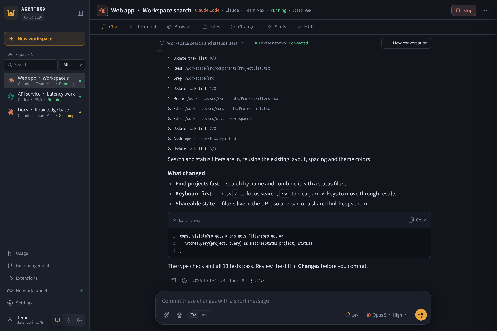</picture></a>

<table>
<tr>
<td width="50%" valign="top"><a href="docs/images/en/chat-live.png">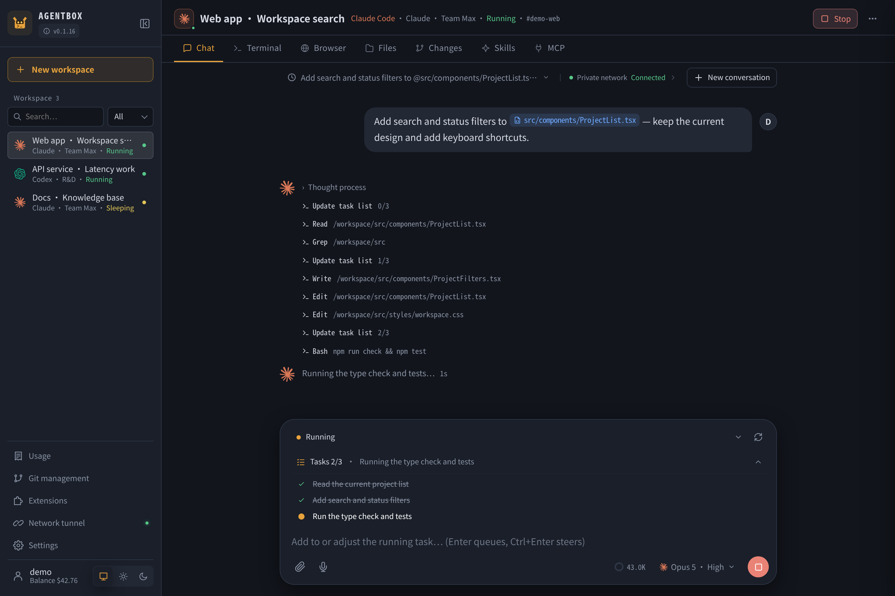</a><br /><strong>A turn in progress</strong><br /><sub>Tool calls as they happen, the agent's task list, the turn timer and the context meter.</sub></td>
<td width="50%" valign="top"><a href="docs/images/en/chat-context.png">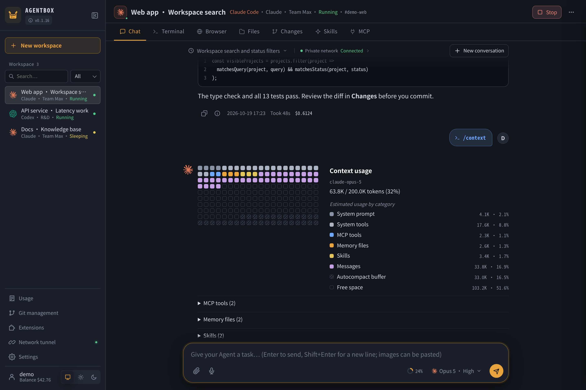</a><br /><strong><code>/context</code> without a model call</strong><br /><sub>Slash commands come from the workspace's Claude Code; context usage is drawn as in the terminal.</sub></td>
</tr>
<tr>
<td valign="top"><a href="docs/images/en/terminal.png">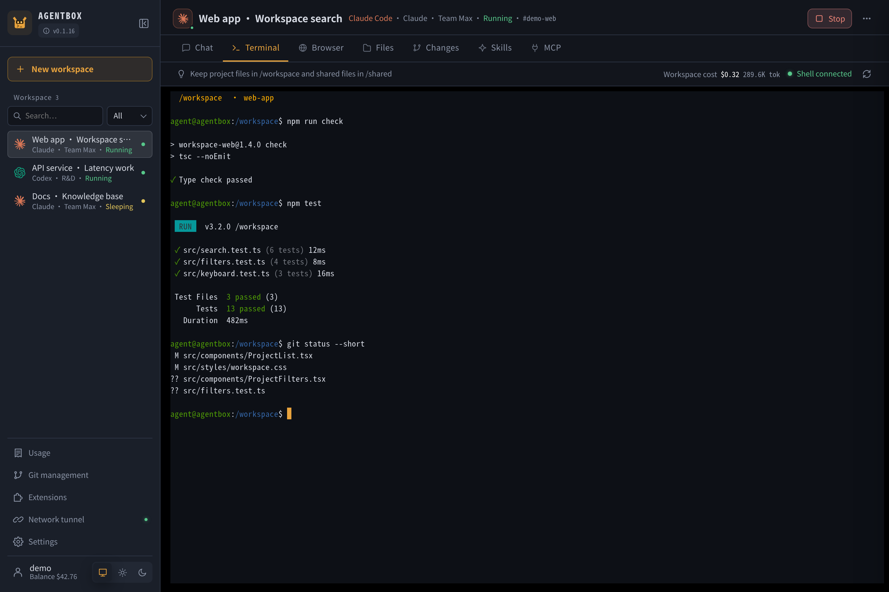</a><br /><strong>The original terminal</strong><br /><sub>A persistent tmux session for the shell or the agent's own CLI.</sub></td>
<td valign="top"><a href="docs/images/en/changes.png">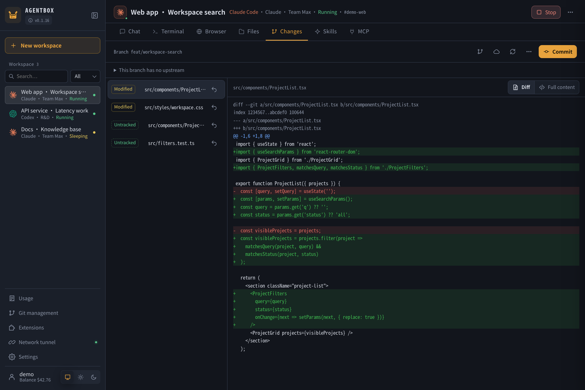</a><br /><strong>Review every change</strong><br /><sub>Per-file diffs before you commit, push or open a PR / MR.</sub></td>
</tr>
<tr>
<td valign="top"><a href="docs/images/en/files.png">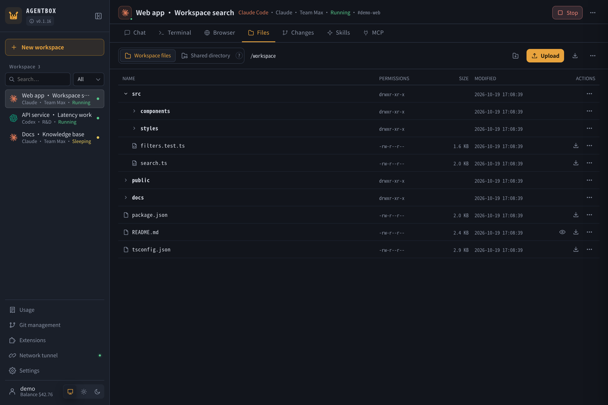</a><br /><strong>Files</strong><br /><sub>Project and shared folders: edit, upload, download.</sub></td>
<td valign="top"><a href="docs/images/en/preview.png">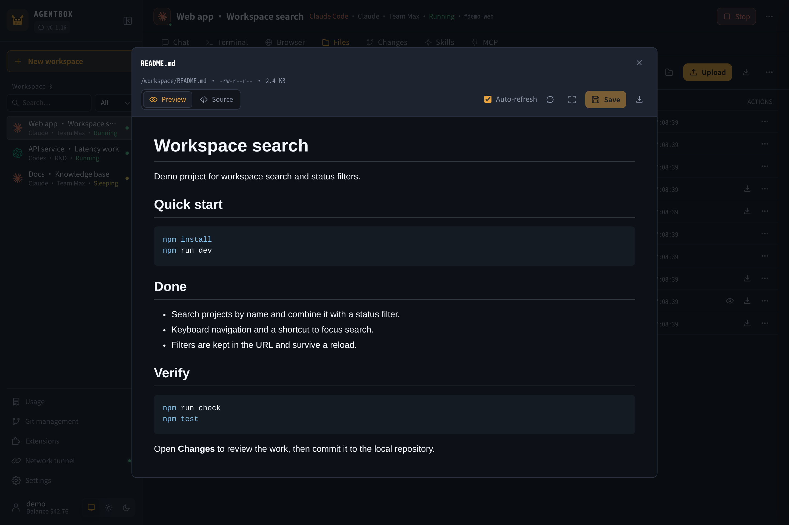</a><br /><strong>Rendered previews</strong><br /><sub>Switch between source and rendered Markdown or HTML.</sub></td>
</tr>
<tr>
<td valign="top"><a href="docs/images/en/usage.png">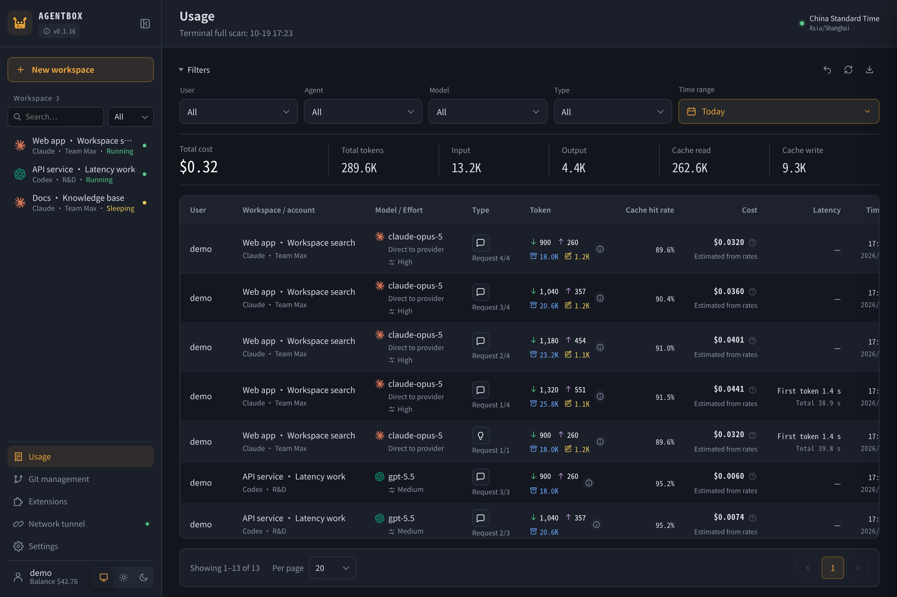</a><br /><strong>Usage, request by request</strong><br /><sub>Filters, totals, cache hit rate, effort, latency and CSV export.</sub></td>
<td valign="top"><a href="docs/images/en/accounts.png">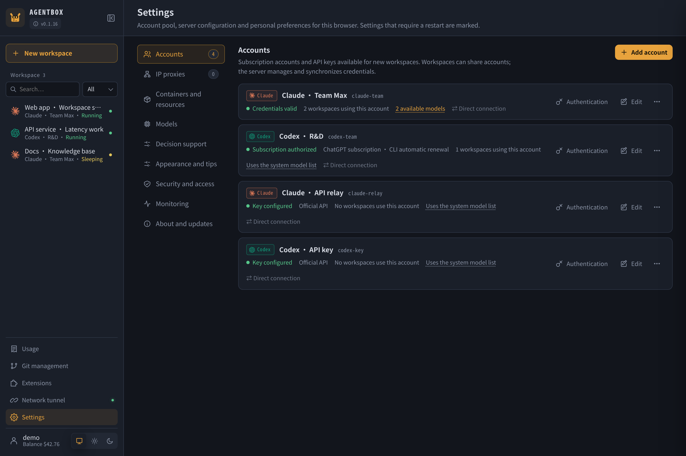</a><br /><strong>Account pool</strong><br /><sub>Subscriptions, API keys and relays with access scopes and models.</sub></td>
</tr>
<tr>
<td valign="top"><a href="docs/images/en/skills.png">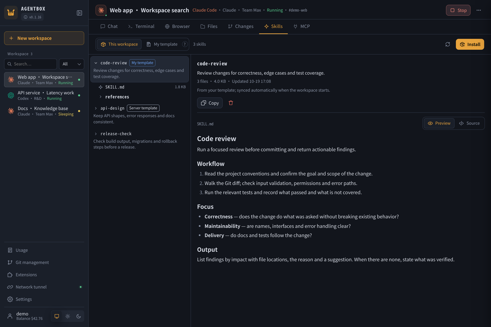</a><br /><strong>Skills</strong><br /><sub>Install into a workspace or your template; browse every file.</sub></td>
<td valign="top"><a href="docs/images/en/mcp.png">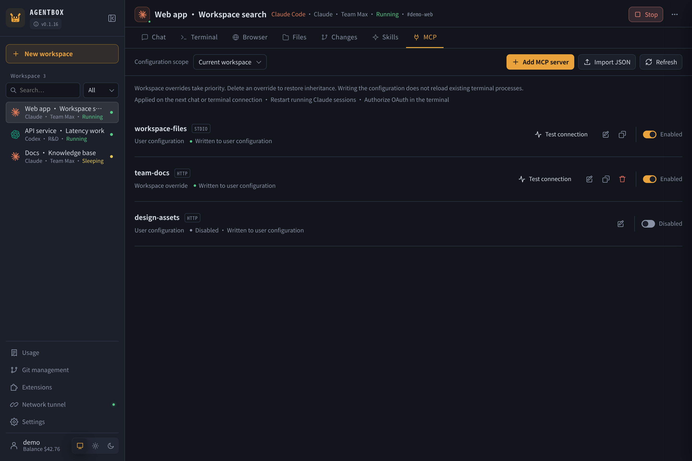</a><br /><strong>MCP servers</strong><br /><sub>User defaults, workspace overrides, JSON import and connection checks.</sub></td>
</tr>
<tr>
<td valign="top"><a href="docs/images/en/extensions.png">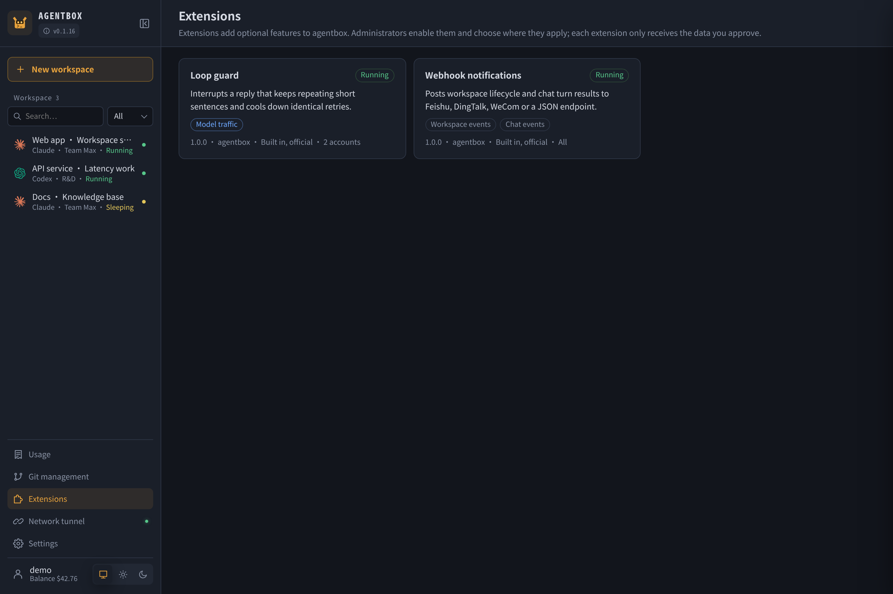</a><br /><strong>Extensions</strong><br /><sub>Approve permissions and choose the accounts or users each one applies to.</sub></td>
<td valign="top"><a href="docs/images/en/tunnel.png">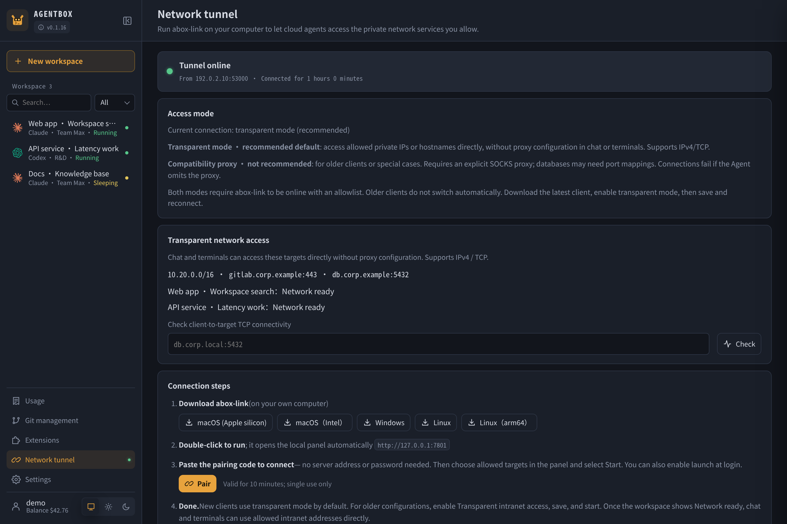</a><br /><strong>Private-network tunnel</strong><br /><sub>abox-link status, allowlist and client downloads.</sub></td>
</tr>
</table>

<a href="docs/images/en/styles.png">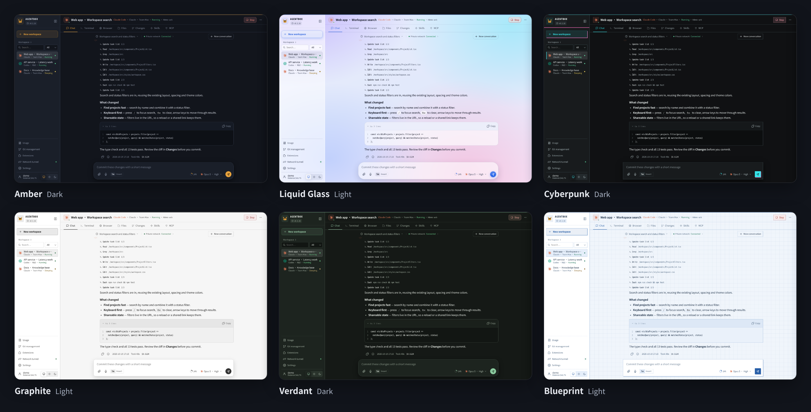</a>

<p align="center"><sub>Six built-in styles, each in light and dark. Custom themes start from one of them.</sub></p>

<p align="center"><a href="docs/images/en/chat-mobile.png">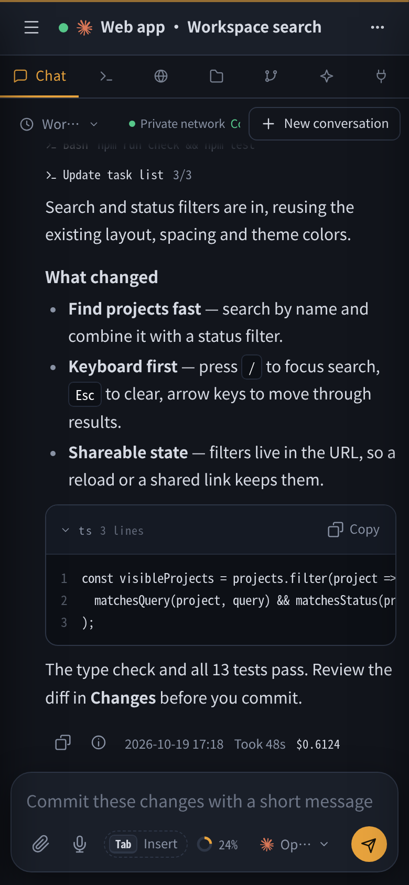</a><br /><sub>The same workspace on a phone.</sub></p>

## Quick start

### Install on your Linux server

```bash
curl -fsSL https://raw.githubusercontent.com/devilcoolyue/agentbox/main/install.sh | sudo bash
```

The installer downloads and verifies the server package, builds the workspace image, and starts `agentbox.service`. **No Go or Node.js installation is needed on the server.** The first image build takes a few minutes and needs access to container registries, Debian repositories, and npm.

- **Host:** Linux x86_64 / arm64, systemd, and local Docker Engine. Ubuntu 22.04+ / Debian 12+ install missing dependencies automatically. For other distributions, see the [prerequisites](deploy/README.md#一键安装).
- **Sign in:** open `http://YOUR_SERVER_IP:8180` and use `boxadmin` with the generated password printed by the installer. Allow TCP 8180 through your firewall if connecting directly; configure [HTTPS](deploy/README.md#https-与-websocket-反向代理) for ongoing public access.
- **Stable server:** [v0.1.16](https://github.com/devilcoolyue/agentbox/releases/tag/v0.1.16). The command selects the latest stable release; append `-s -- --version v0.1.16` to pin it, or `-s -- --listen 127.0.0.1:8180` to bind only to localhost.
- **Existing installation:** use About and updates in the console or the [upgrade guide](docs/releases.md#升级与回退). The installer preserves existing deployments and will not overwrite them.

Configuration lives in `/etc/agentbox`, data in `/var/lib/agentbox`. Each workspace defaults to a 2 GiB memory limit and 2 CPUs; size your server for the number of concurrent workspaces. See [installation and recovery](deploy/README.md#一键安装) for all options.

### Your first task

On first sign-in a role-based guide walks administrators through the environment check, accounts and default models; users see the accounts they may use.

1. **Add an account** in System settings → Account pool. Choose Claude or Codex and connect a subscription or an API / relay account. Fetch the provider's models, keep the ones this account offers, and set reasoning effort per model; when a relay cannot list models, start from the official catalog that ships with the CLIs in the Agent image. [Account setup →](docs/accounts-and-models.md)
2. **Create a workspace** from an empty project, an uploaded archive or a Git repository, and pick its agent and account. You can later switch to another account of the same agent from the workspace ⋯ menu. [Project import →](docs/project-creation.md)
3. **Describe the task in Chat.** Mention files with `@`, run commands in Terminal, and open Files to check the result; all of them work on the same project files.
4. **Review Changes** before committing. Download the result, or configure a Git connection to push and open a PR / MR. [Workspace guide →](docs/user-guide.md)

<details>
<summary><strong>Prefer to build from source?</strong></summary>

On Linux with Docker, Git, and the Go toolchain in [go.mod](go.mod):

```bash
git clone https://github.com/devilcoolyue/agentbox.git
cd agentbox
go build -o agentbox ./cmd/agentbox
./scripts/build-image.sh
openssl rand -hex 24
```

Save the following as `config.json`, replacing the password placeholder with the generated random value:

```json
{
  "listen": "127.0.0.1:8180",
  "auth_token": "CHANGE_ME_TO_A_LONG_RANDOM_TOKEN",
  "data_dir": "data",
  "agent_image": "agentbox-agent:latest",
  "accounts": [],
  "proxies": []
}
```

```bash
sudo ./agentbox -config config.json
```

Open `http://127.0.0.1:8180` on the server, or run `ssh -N -L 8180:127.0.0.1:8180 user@your-server` on your computer and open that address locally. Sign in as `boxadmin` with the configured `auth_token`. After first startup the password is stored in the database; editing `auth_token` does not reset it. If you forget it, stop the service and run `agentbox admin-reset-password --config /path/to/config.json --user boxadmin` (see the [recovery procedure](docs/troubleshooting.md#忘记密码或改了-auth_token-仍不能登录)).

The server needs Docker access and permission to set mounted directory ownership to `1000:1000`. After stopping this foreground instance, run `sudo ./deploy/install.sh` and `sudo ./deploy/deploy.sh` for a source-based systemd installation. See [deployment](deploy/README.md), [configuration](docs/configuration.md), and [development](docs/development.md) for details.

</details>

## How it works

**One Go server, SQLite, and Docker.** The frontend is embedded in the server binary. Each workspace gets its own container; files and history persist on the host.

[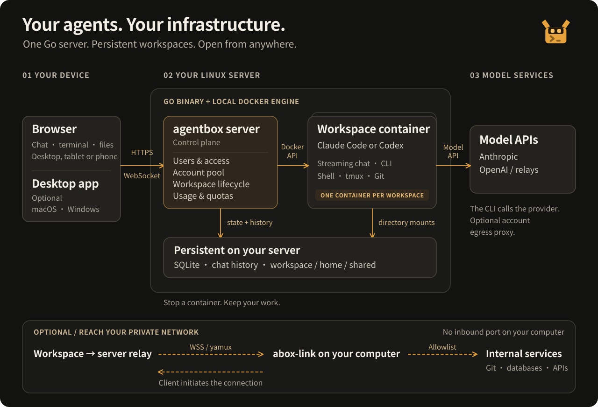](docs/images/architecture.svg)

| Layer | Responsibility |
| --- | --- |
| **Browser / optional desktop** | Connect to the server and interact with your workspaces |
| **Agentbox server** | Authentication, account access, workspace lifecycle, HTTP / WebSocket, Git operations, usage and credits, extensions |
| **Workspace containers** | Run Claude Code / Codex CLI and project tools; communicate with your configured model provider |
| **Persistent storage** | SQLite state and ledger, project files, home directories, shared files, and JSONL chat history |
| **Optional abox-link** | Connect private services reachable from your computer through an explicit allowlist |

Chat and terminal share files, **not an automatic conversation context**. Each workspace supports multiple chat threads and one active Web chat turn at a time (later messages queue); long threads open at the newest messages and load earlier ones as you scroll up. Each user's `/shared` directory is available across their workspaces. Stopping a container retains files and history but ends its processes.

## Choose your entry point

| Entry point | Use it for | Availability |
| --- | --- | --- |
| **Web console** | Chat, original CLI terminal, files, Git, skills, MCP, and administration | Included in the server; no local agent installation |
| **Desktop app** | Native Windows/macOS access, project terminals, file transfer, and optional sync | [Download 0.1.2](https://github.com/devilcoolyue/agentbox/releases/tag/desktop-v0.1.2) · unsigned public test release |
| **abox-link** | Allowlisted private-network access from cloud workspaces | Optional; local panel or headless command line on Windows, macOS, and Linux |
| **HTTP / WebSocket API** | Script workspace operations and usage queries | [API reference](docs/api.md) |

The desktop app connects to your server; it does not replace or upgrade it. **Sync is disabled by default and requires an administrator to enable it.** Desktop 0.1.2 is a manual download (macOS not notarized, Windows unsigned, no automatic updates) and predates the multilingual UI that the desktop source now has. See the [desktop guide](desktop/README.md).

Optional server features: a [remote browser image](docs/remote-browser.md) gives a workspace a full browser desktop with persistent website logins; [shared tools](docs/shared-tools.md) provide read-only Go SDKs and browsers with per-user caches; [local storage capacity management](docs/storage-capacity.md) adds per-user project quotas and cache cleanup. Agent image updates build from a fixed base and are validated before they switch ([image maintenance](docs/agent-image-validation.md)).

## Know the boundaries

- **Use trusted accounts with trusted users.** Credentials are made available to the CLI inside containers and can be read by users with terminal access. Account scopes restrict admission; revoking access does not withdraw credentials already delivered or terminate existing processes. See [account permissions](docs/accounts-and-models.md#账号使用范围).
- **Persistent files are not persistent processes.** Keep durable files in `/workspace`, `/home/agent`, or `/shared`. Stopping, rebuilding, or idle suspension ends container processes; a browser disconnect alone does not immediately stop the container.
- **Credits are not hard spending caps.** Web chat settles each model request as it completes, but balance is only checked before a turn starts, so the final admitted turn may overspend. Terminal usage is recorded without deducting credits. See [usage and quotas](docs/usage-and-quotas.md).
- **Back up user files explicitly.** Default system backups cover configuration, credentials, database state, templates, and MCP management state; they exclude workspace files and chat history. Full backups require stopping the service and relevant containers. See [backup and restore](deploy/README.md#备份与恢复).
- **Deploy within a trusted server boundary.** Agentbox uses a local Docker daemon and one server process per data directory. Agents execute code with `bypassPermissions` by default; containers use a non-root user and resource limits. Deployments briefly disconnect clients.
- **Review and push are separate actions.** Web commits do not run hooks or signing and do not automatically push. Use the terminal when you need those commit behaviors. See [Git management](docs/architecture/git-management.md).

## Documentation

English and Chinese READMEs cover the same overview and setup. Detailed guides are currently in Chinese; start with the [documentation index](docs/README.md).

| You want to… | Read |
| --- | --- |
| Use chat, terminal, files, previews, and Git | [Workspace guide](docs/user-guide.md) |
| Connect accounts or choose models | [Accounts and models](docs/accounts-and-models.md) |
| Reuse skills, templates, and MCP tools | [Skills, plugins, and MCP](docs/skills-and-mcp.md) |
| Understand or manage costs | [Usage and credits](docs/usage-and-quotas.md) · [Pricing catalogs](docs/pricing-catalog.md) |
| Turn on extensions or stop repetitive model output | [Extensions and SPI](docs/architecture/extensions-spi.md) · [Standalone loop guard (preview)](docs/loop-guard.md) |
| Let a strong model hand work to cheaper ones | [Supervisor delegation](docs/architecture/delegation-supervisor.md) |
| Connect private services | [Proxies and abox-link](docs/networking.md) |
| Install, upgrade, back up, or recover | [Deployment](deploy/README.md) · [Releases](docs/releases.md) · [CLI compatibility](docs/compatibility.md) |
| Configure or integrate the server | [Configuration](docs/configuration.md) · [API reference](docs/api.md) |
| Choose a language or make a theme | [Languages](docs/i18n.md) · [Interface themes](docs/themes.md) |
| Resolve an error | [Troubleshooting](docs/troubleshooting.md) · [Error codes](docs/errors.md) · [Diagnostics](docs/diagnostics.md) |
| See what changed | [Changelog](CHANGELOG.md) · [Capabilities and verification](docs/capabilities.md) |
| Contribute code | [Development guide](docs/development.md) · [Contributing](CONTRIBUTING.md) |

## Development roadmap

The current server release is **v0.1.16** (2026-10-19). Recent releases added supervisor delegation, the theme editor and local storage capacity management (v0.1.13); questions, follow-ups, `/` commands, `@` mentions, the context meter, the task list and per-request billing (v0.1.14); and extensions, webhook notifications, the turn timer and background Git network operations (v0.1.16). See the [changelog](CHANGELOG.md).

The first round (M1–M5: diagnostics, onboarding, reliable chat, maintenance quality, desktop consistency) shipped in v0.1.11; its external acceptance — real-user observations, performance thresholds, recovery targets and desktop signing — is still pending ([record](docs/milestones/backlog.md)). The second round continues it:

| Milestone | Planned focus |
| --- | --- |
| **M6 · Wrap-up and formal release** | Commit the development tree, run hosted CI end to end, release v0.1.11 and align documented version status ([record](docs/milestones/m6.md)) |
| **M7 · Real-use acceptance and metrics baseline** | In-instance aggregate metrics with redacted export, real task observations, agreed performance thresholds and recovery targets |
| **M8 · Feedback-driven daily efficiency** | Fix the most frequent blockers found in observations; candidates: workspace archiving, task completion notifications, long-conversation rendering |
| **M9 · Upstream updates and installation cost** | Prebuilt Agent images, CLI baseline advancement, routine dependency upgrades, broader contract generation |
| **M10 · Stable desktop release** | OS signing and notarization, minimum OS and real devices, a full sync pilot cycle; a test release if certificates are unavailable |
| **M11 · Additional agents** | Provider registry and ACP transport, optional agents in the image; Kimi Code CLI first |

Each iteration is scoped to about **3 weeks**; order and scope follow user feedback and acceptance results, and these are not release-date commitments. Scope, dependencies and acceptance criteria are in the [second-round plan](docs/roadmap-2.md) and the sealed [first-round plan](docs/roadmap.md) (both Chinese). Issues with concrete use cases are welcome.

## Build and contribute

The [capability and verification inventory](docs/capabilities.md) separates implemented features, release records, and pending acceptance. Run `python3 scripts/verify.py list` to choose checks or `python3 scripts/verify.py run quick` for local checks with saved reports; see the [verification guide](docs/verification.md).

The server uses **Go + SQLite + Docker**; the browser console uses **TypeScript, native ES Modules, and xterm.js**. See the [development guide](docs/development.md) for toolchains and platform-specific checks.

```bash
go build ./...
go test ./...

# If you edit the frontend
npm ci
npm run check
npm run build
```

Commit generated `internal/web/static/js/` files alongside changes to `web/src/`. Full container validation targets Linux; macOS builds and unit tests do not replace it. The screenshots and tour above are regenerated from the shipped UI with `scripts/capture-readme.mjs` and `scripts/render-readme-tour.mjs` ([capture guide](docs/development.md#文档截图)).

Useful bug reports, workflow suggestions, and focused pull requests are welcome. Include reproduction steps and sanitized logs; report vulnerabilities privately via [SECURITY.md](SECURITY.md). If agentbox is useful to you, a **Star** helps other developers discover it.

## License and community

[Apache-2.0](LICENSE) · [Copyright notices](NOTICE) · [Third-party licenses](third_party/README.md) · [Changelog](CHANGELOG.md)

Model services and runtime CLIs retain their upstream terms. Thanks to the [LINUX DO](https://linux.do) community for its support and discussions.
