<div align="center">


# agentbox

**把 AI 编码工作台，放在自己的服务器上。**

在 Linux 服务器运行 Claude Code 与 Codex CLI，打开浏览器即可使用。<br /> 从一句任务到审查代码，对话、终端、文件与 Git 都在同一个工作空间。

[](https://github.com/devilcoolyue/agentbox/releases/latest) [](go.mod) [](images/agent/Dockerfile) [](LICENSE)

[English](README.md) | **简体中文**

[操作演示](#操作演示) · [功能亮点](#功能亮点) · [界面预览](#界面预览) · [快速开始](#快速开始) · [整体架构](#整体架构) · [使用文档](#使用文档)

</div>

## 操作演示

<a href="docs/media/agentbox-tour-zh-CN.mp4?raw=1">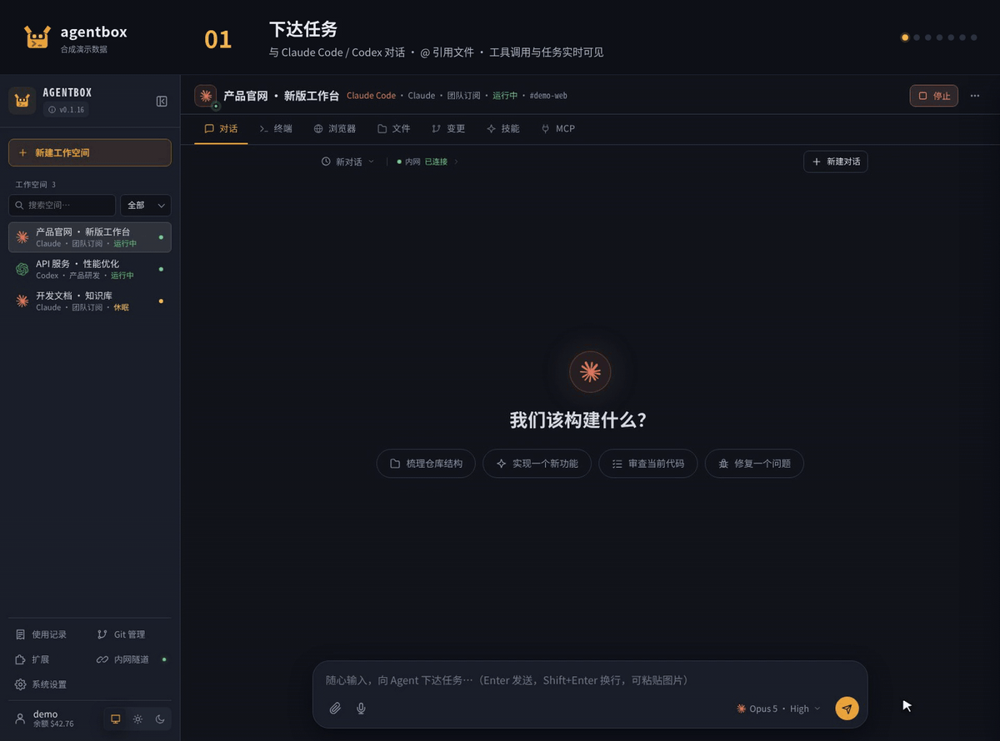</a>

<p align="center"><a href="docs/media/agentbox-tour-zh-CN.mp4?raw=1"><strong>▶ 观看 1920 像素完整版（MP4，65 秒）</strong></a> —— 另含文件预览、使用记录与六种界面风格切换 · <a href="#界面预览">界面截图</a></p>

<sub>录自真实网页控制台，项目、对话、命令输出和用量均为合成演示数据，没有调用模型；用于说明界面，不代表模型效果或速度。</sub>

## 为什么使用 agentbox？

在服务器上配置一次编码环境，之后从笔记本、台式机或手机继续项目。本机只需浏览器；Agent 和项目工具在服务端的 Docker 容器里运行。

| 你要做的事 | agentbox 提供的工作方式 |
| --- | --- |
| **随时继续上次的工作** | 项目文件、home 配置和对话历史持久保存，关闭浏览器后仍在 |
| **使用熟悉的 Agent** | Claude Code 与 Codex CLI，支持网页流式对话和原版交互式终端 |
| **在一个地方完成交付** | 上传或克隆 → 对话 → 运行与预览 → 审查 diff → 提交、推送或下载 |
| **复用自己的环境** | 用户级共享目录、分层 home 模板、Claude 技能与支持空间覆盖的 MCP 配置 |
| **让可信团队统一使用** | 集中账号池、按用户授权、逐次请求的用量明细、价格快照与可选额度 |
| **连接自己的服务** | 可选 abox-link 隧道，访问白名单内的代码仓库、数据库与其他内网服务 |

你准备服务器，以及自己的 Claude / Codex 订阅、API Key 或兼容中转账号。Agentbox 提供工作空间和管理能力，模型调用遵循对应服务商的条款与计费。

## 功能亮点

### 跟得上命令行的网页对话

- **看得见 Agent 在做什么。** 回复流式输出，附思考摘要和每一次工具调用，Codex 的命令照它的命令行归类（Read、Search、Shell、Edit），带退出码与用时，点开即见输出和 diff；输入框上方是 Agent 的任务列表（「任务 2/3 · 正在运行测试」），回合计时逐秒走，圆环显示上下文窗口占用，与命令行状态栏一致。
- **`@` 引用文件，`/` 调用命令。** 敲 `@` 按名字搜索工作区文件并填入路径；敲 `/` 列出空间里 Claude Code 实际可用的命令。`/context` 画成与终端一样的彩色格子图，订阅账号的 `/usage` 显示为额度进度条，都在本地作答、不调用模型。
- **随时插话。** Claude 执行中提问时，在卡片里作答，同一轮带着回答继续；Agent 干活时可以接着发消息，排到下一轮或引导进当前回合；每轮结束后，预测的下一句以灰字等你按 Tab。（提问、引导与下一步提示仅限 Claude 空间。）
- **不丢消息。** 未发送的草稿、发送前冻结的副本和逐条回执在刷新、断线和服务重启后仍可恢复；结果不确定时交给你核对，不会自动重跑。

### 原版 CLI、文件与 Git

- **终端：** Shell、Claude Code 或 Codex 跑在持久 tmux 会话里，断线重连不丢；支持触屏滚动、长按粘贴和复制到本机剪贴板。
- **文件：** 在项目与 `/shared` 中浏览、编辑、上传压缩包和下载；Markdown 与 HTML 可切换为渲染预览。
- **Git：** 逐文件查看 diff 并提交；通过 HTTPS Token、SSH 或 GitHub / GitLab OAuth 获取、拉取、预览推送并创建 PR / MR，耗时的网络操作在后台执行。

### 为可信团队准备

- **账号：** 订阅、API Key 与中转账号集中在账号池，按用户授权，逐账号配置可用模型与推理强度；空间可切换到同类型的其他账号。
- **用量与费用：** 每次模型请求一条记录，含 token、缓存、延迟、推理强度及入账时的价格快照；终端用量同样记录。Claude Code 与 Codex 经遥测上报每次请求的首字与耗时，据此给出实测的延迟与输出速度（tok/s）；没有上报的请求按 CLI 日志估算。可选额度余额与 CSV 导出。
- **复用：** Claude 技能（含官方市场）、分层 home 模板，以及用户默认 + 空间覆盖的 MCP 配置。
- **内网：** 配对 abox-link 访问白名单内的内网服务；每个账号可走自己的出口代理。

### 扩展、委派与个性化

- **扩展**由管理员逐个启用：「循环保护」在模型反复说同样的短句时中断回复（API Key 与中转账号），「Webhook 通知」把空间和回合事件推送到飞书、钉钉、企业微信或任意 JSON 地址。[设计 →](docs/architecture/extensions-spi.md)
- **主管委派（开发预览）：** 强模型主 Agent 把规则明确的子任务交给更便宜的跑腿模型，在同一个空间里完成。[设计 →](docs/architecture/delegation-supervisor.md)
- **风格与语言：** 六种内置风格 × 浅色 / 深色，可实时预览的自定义主题编辑器，简体中文 · 繁體中文 · English，以及手机布局。[界面主题 →](docs/themes.md)

各项对话功能的细节（以及哪些需要较新的 Agent 镜像）见[工作空间指南](docs/user-guide.md#对话)。

## 界面预览

截图均为 2 倍像素密度的 PNG，点击可查看原图。

<a href="docs/images/zh-CN/chat-dark.png"><picture><source media="(prefers-color-scheme: light)" srcset="docs/images/zh-CN/chat-light.png" />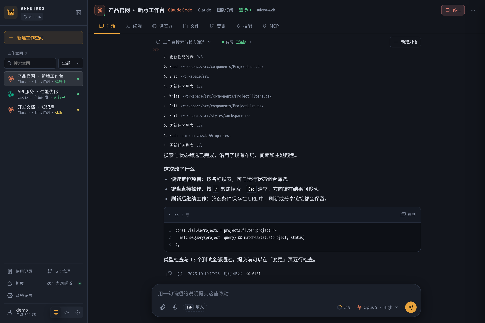</picture></a>

<table>
<tr>
<td width="50%" valign="top"><a href="docs/images/zh-CN/chat-live.png">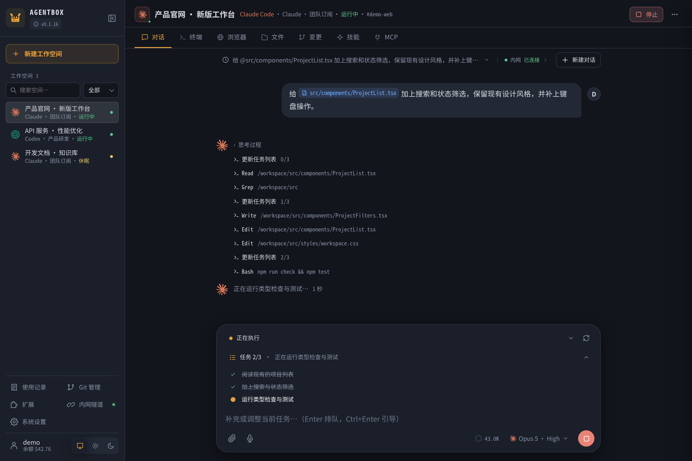</a><br /><strong>回合进行中</strong><br /><sub>工具调用实时出现，附任务列表、回合计时和上下文占用。</sub></td>
<td width="50%" valign="top"><a href="docs/images/zh-CN/chat-context.png">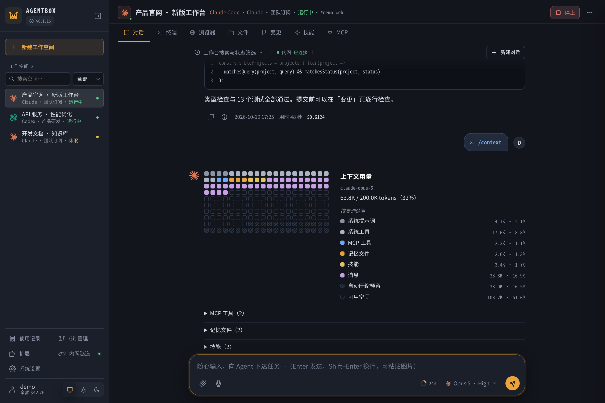</a><br /><strong>不调用模型的 <code>/context</code></strong><br /><sub>斜杠命令来自空间里的 Claude Code，上下文占用画得与终端一致。</sub></td>
</tr>
<tr>
<td valign="top"><a href="docs/images/zh-CN/terminal.png">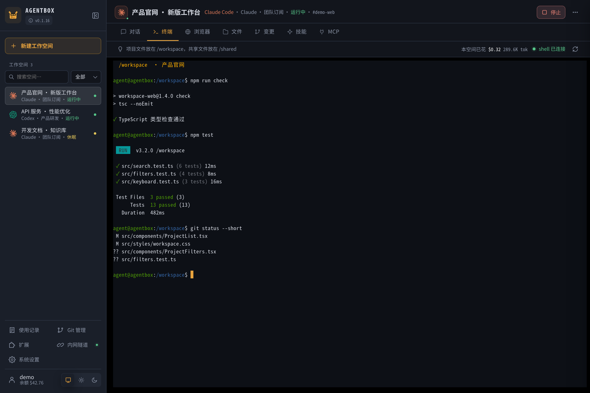</a><br /><strong>原版终端</strong><br /><sub>持久 tmux 会话，运行 Shell 或 Agent 自己的 CLI。</sub></td>
<td valign="top"><a href="docs/images/zh-CN/changes.png">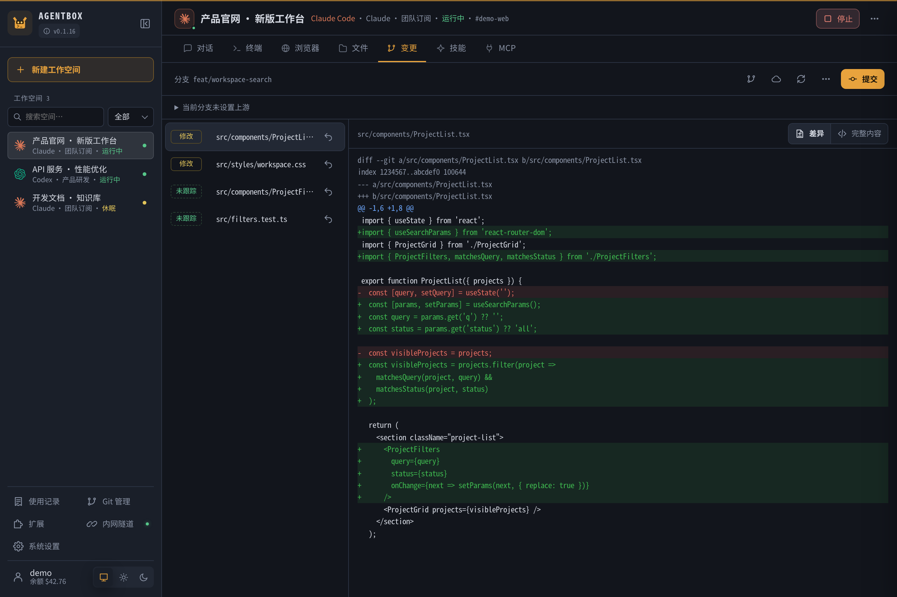</a><br /><strong>逐行审查改动</strong><br /><sub>提交、推送或创建 PR / MR 之前，按文件查看 diff。</sub></td>
</tr>
<tr>
<td valign="top"><a href="docs/images/zh-CN/files.png">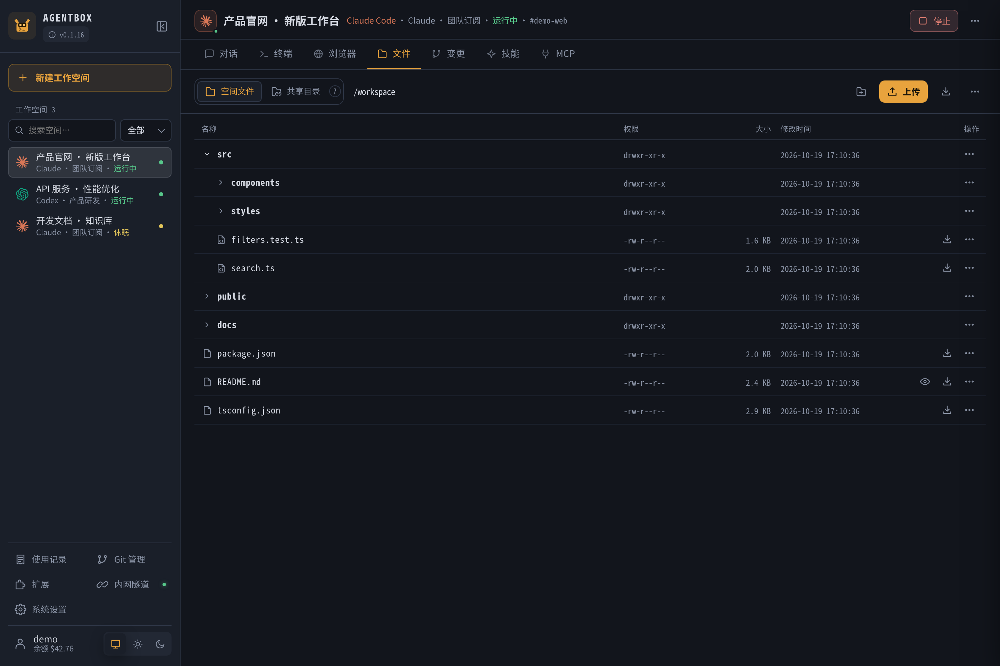</a><br /><strong>文件</strong><br /><sub>项目与共享目录：编辑、上传、下载。</sub></td>
<td valign="top"><a href="docs/images/zh-CN/preview.png">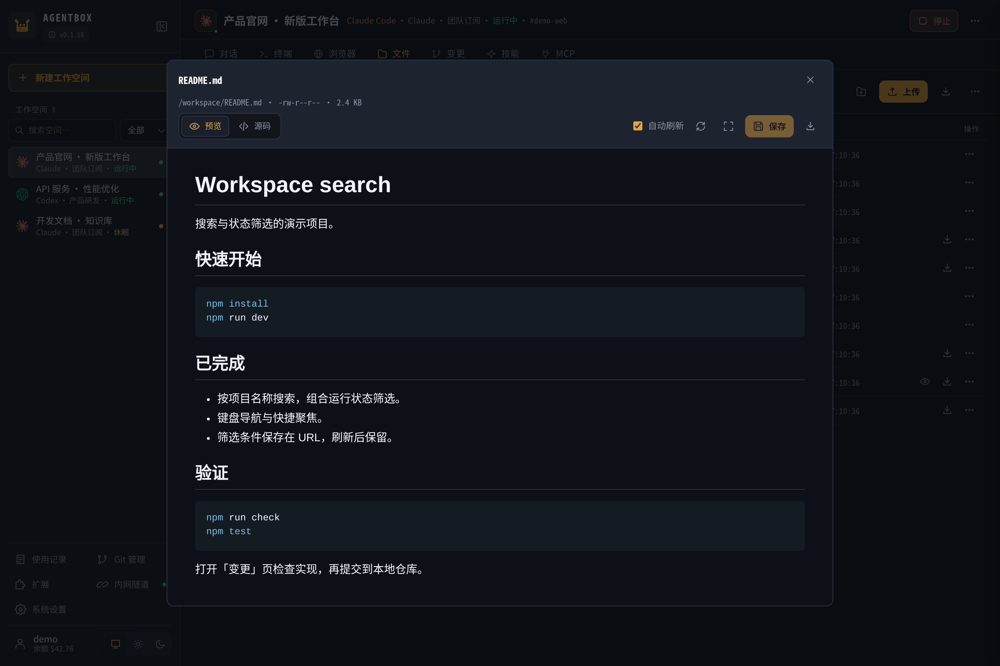</a><br /><strong>渲染预览</strong><br /><sub>源码与渲染后的 Markdown / HTML 一键切换。</sub></td>
</tr>
<tr>
<td valign="top"><a href="docs/images/zh-CN/usage.png">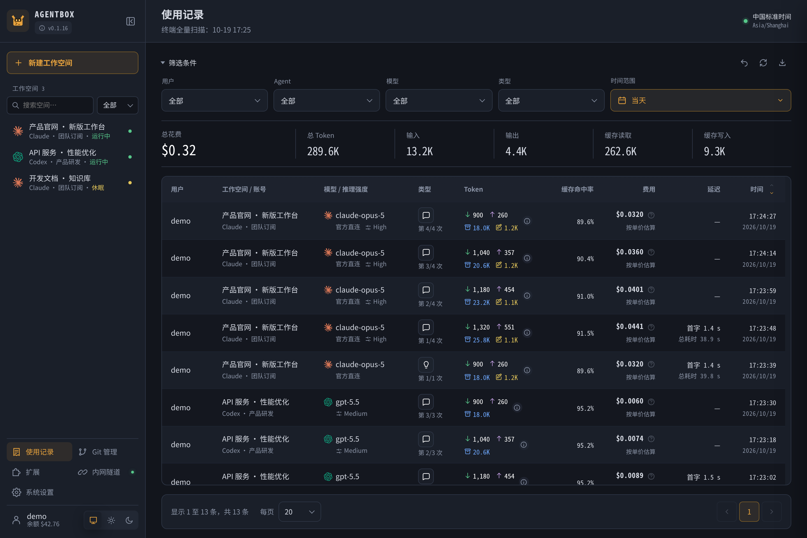</a><br /><strong>逐次请求的使用记录</strong><br /><sub>筛选、合计、缓存命中率、推理强度、延迟与 CSV 导出。</sub></td>
<td valign="top"><a href="docs/images/zh-CN/accounts.png">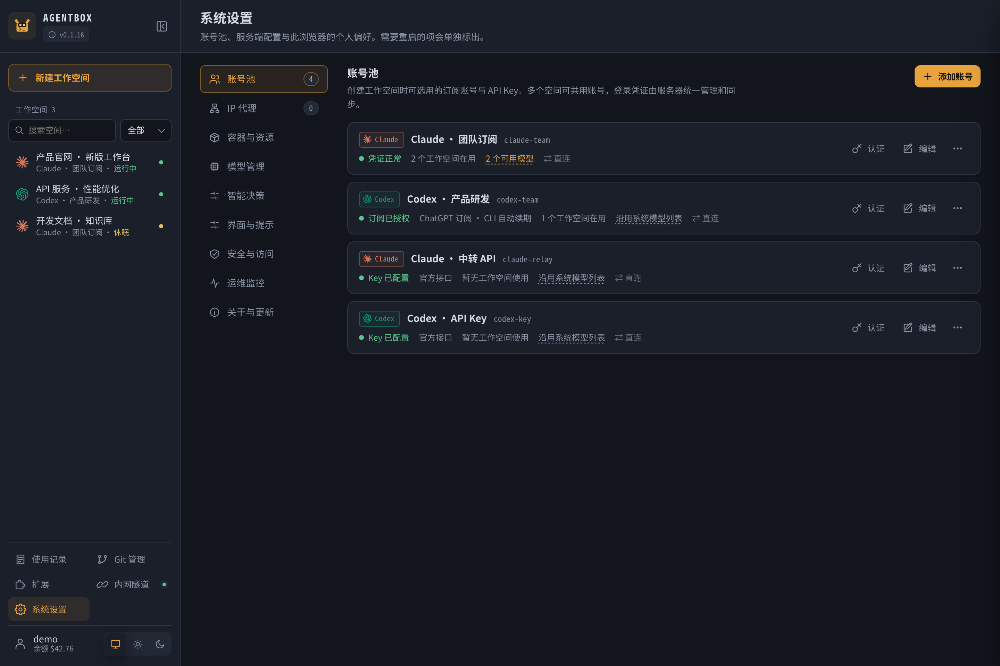</a><br /><strong>账号池</strong><br /><sub>订阅、API Key 与中转账号，附使用范围与可用模型。</sub></td>
</tr>
<tr>
<td valign="top"><a href="docs/images/zh-CN/skills.png">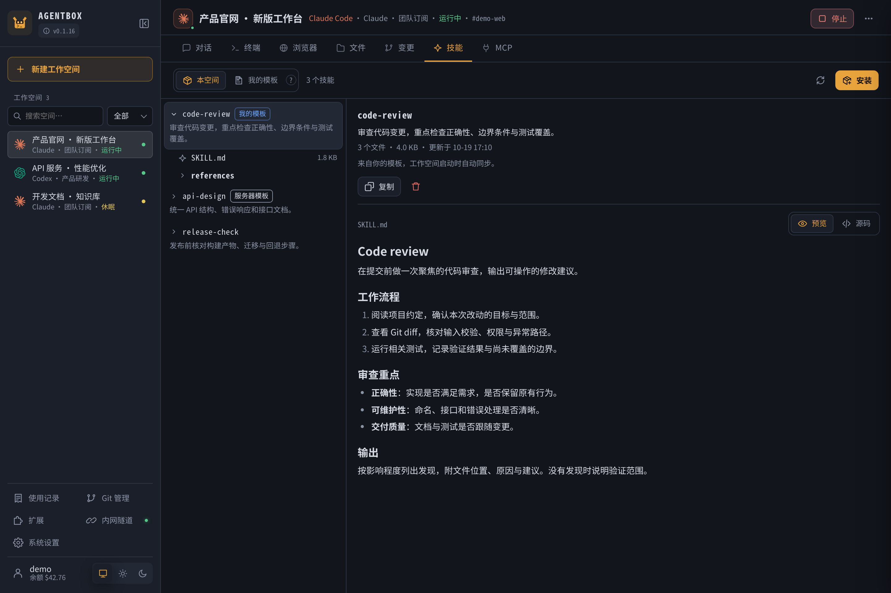</a><br /><strong>技能</strong><br /><sub>装到当前空间或用户模板，逐个文件查看。</sub></td>
<td valign="top"><a href="docs/images/zh-CN/mcp.png">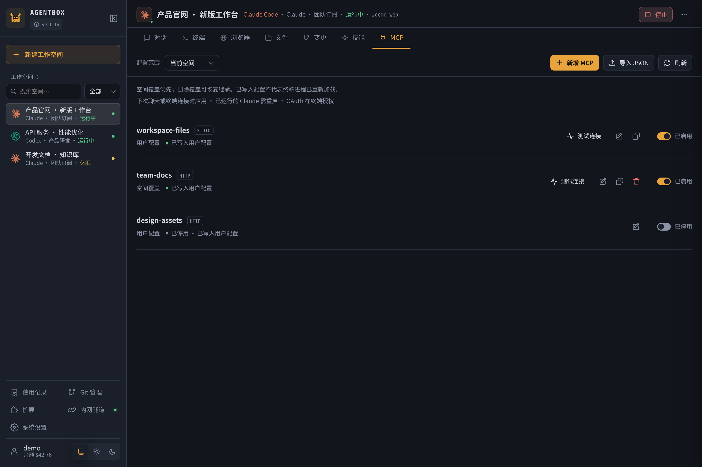</a><br /><strong>MCP 服务</strong><br /><sub>用户默认、空间覆盖、JSON 导入与连接检测。</sub></td>
</tr>
<tr>
<td valign="top"><a href="docs/images/zh-CN/extensions.png">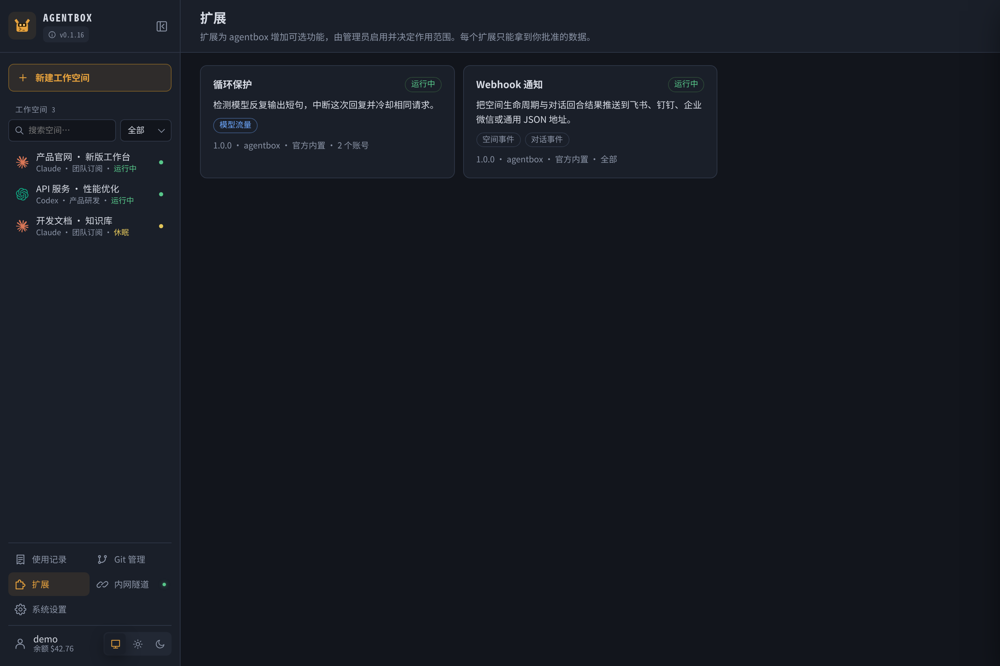</a><br /><strong>扩展</strong><br /><sub>逐项批准权限，选择作用于哪些账号或用户。</sub></td>
<td valign="top"><a href="docs/images/zh-CN/tunnel.png">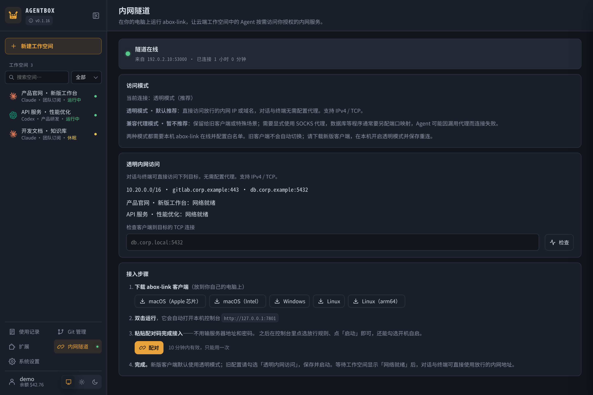</a><br /><strong>内网隧道</strong><br /><sub>abox-link 状态、白名单与客户端下载。</sub></td>
</tr>
</table>

<a href="docs/images/zh-CN/styles.png">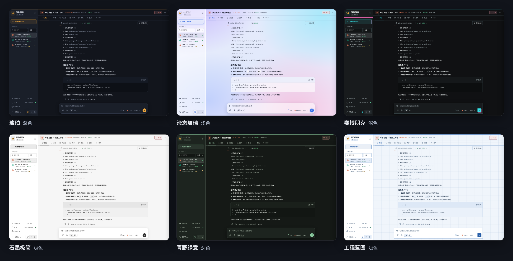</a>

<p align="center"><sub>六种内置风格，各有浅色与深色；自定义主题以其中一种为底子。</sub></p>

<p align="center"><a href="docs/images/zh-CN/chat-mobile.png">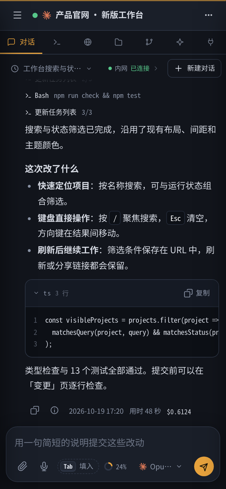</a><br /><sub>同一个空间在手机上的样子。</sub></p>

## 快速开始

### 在 Linux 服务器安装

```bash
curl -fsSL https://raw.githubusercontent.com/devilcoolyue/agentbox/main/install.sh | sudo bash
```

安装器会下载并校验服务端发布包、构建工作空间镜像，再启动 `agentbox.service`。**服务器无需安装 Go 或 Node.js。** 首次构建镜像需要几分钟，以及访问容器镜像源、Debian 软件源和 npm 的网络。

- **运行环境：** Linux x86_64 / arm64、systemd 与本机 Docker Engine。Ubuntu 22.04+ / Debian 12+ 会自动安装缺失依赖；其他发行版见[安装前提](deploy/README.md#一键安装)。
- **打开登录：** 访问 `http://服务器IP:8180`，使用安装完成时显示的 `boxadmin` 和随机密码。直接远程访问需放行 TCP 8180；公网长期使用请配置 [HTTPS](deploy/README.md#https-与-websocket-反向代理)。
- **服务端正式版：** [v0.1.16](https://github.com/devilcoolyue/agentbox/releases/tag/v0.1.16)。命令默认安装最新正式版；末尾加 `-s -- --version v0.1.16` 可固定版本，加 `-s -- --listen 127.0.0.1:8180` 可限制为仅本机监听。
- **已有部署：** 使用控制台「关于与更新」或[升级指南](docs/releases.md#升级与回退)。安装器会保留已有部署，不覆盖安装。

配置位于 `/etc/agentbox`，数据位于 `/var/lib/agentbox`。每个空间默认限制 2 GiB 内存、2 CPU，请按并发空间数准备资源。完整选项与失败恢复见[安装说明](deploy/README.md#一键安装)。

### 完成第一个任务

首次登录时，按角色出现使用指南：管理员检查环境、接入账号、确认默认模型；普通用户查看自己可用的账号。

1. **添加账号：** 在「系统设置 → 账号池」选择 Claude 或 Codex，接入订阅或 API / 中转账号。从上游读取模型，保留这个账号能用的模型并按模型设置推理强度；中转站读不到模型列表时，可从 Agent 镜像内 CLI 自带的官方目录开始。[账号配置 →](docs/accounts-and-models.md)
2. **创建空间：** 从空项目、上传的压缩包或 Git 仓库创建，选择 Agent 和账号；之后可在空间 ⋯ 菜单「切换账号」改用同类型的其他账号。[项目导入 →](docs/project-creation.md)
3. **在对话里描述任务：** 用 `@` 引用文件，在「终端」执行命令，在「文件」查看结果；它们操作同一份项目文件。
4. **审查并交付：** 在「变更」查看 diff，再提交代码。可以直接下载产物，也可以配置 Git 连接后推送并创建 PR / MR。[操作指南 →](docs/user-guide.md)

<details>
<summary><strong>希望从源码构建？</strong></summary>

在准备好 Docker、Git 和 [go.mod](go.mod) 对应 Go 工具链的 Linux 服务器执行：

```bash
git clone https://github.com/devilcoolyue/agentbox.git
cd agentbox
go build -o agentbox ./cmd/agentbox
./scripts/build-image.sh
openssl rand -hex 24
```

将下面内容保存为 `config.json`，先把密码占位符换成刚生成的随机字符串：

```json
{
  "listen": "127.0.0.1:8180",
  "auth_token": "CHANGE_ME_TO_A_LONG_RANDOM_TOKEN",
  "data_dir": "data",
  "agent_image": "agentbox-agent:latest",
  "accounts": [],
  "proxies": []
}
```

```bash
sudo ./agentbox -config config.json
```

服务器本机打开 `http://127.0.0.1:8180`；远程使用可在自己的电脑运行 `ssh -N -L 8180:127.0.0.1:8180 user@your-server`，再打开同一地址。使用 `boxadmin` 和配置中的 `auth_token` 登录。首次启动后密码保存在数据库，修改 `auth_token` 不会重置它；忘记时先停服，再运行 `agentbox admin-reset-password --config /配置路径/config.json --user boxadmin`（见[密码恢复](docs/troubleshooting.md#忘记密码或改了-auth_token-仍不能登录)）。

服务端需要 Docker 访问权，以及为挂载目录设置 `1000:1000` 属主的权限。结束前台试跑后，执行 `sudo ./deploy/install.sh` 和 `sudo ./deploy/deploy.sh`，以源码目录方式交给 systemd 托管。详见[部署手册](deploy/README.md)、[配置参考](docs/configuration.md)和[开发指南](docs/development.md)。

</details>

## 整体架构

**一个 Go 服务端，加上 SQLite 和 Docker。** 网页资源嵌入服务端二进制；每个工作空间有自己的容器，文件与历史保存在宿主机。

[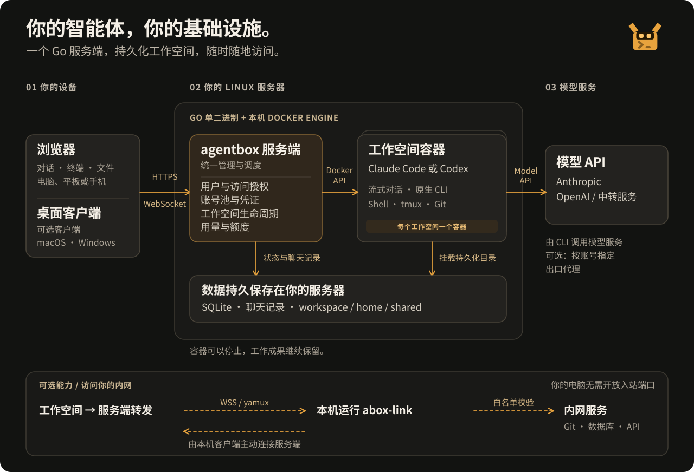](docs/images/architecture-cn.svg)

| 层次 | 负责什么 |
| --- | --- |
| **浏览器 / 可选桌面端** | 连接服务端，进入自己的工作空间 |
| **Agentbox 服务端** | 登录鉴权、账号授权、空间生命周期、HTTP / WebSocket、Git 操作、用量和额度、扩展 |
| **工作空间容器** | 运行 Claude Code / Codex CLI 和项目工具，连接配置的模型服务商 |
| **持久存储** | SQLite 状态与账本、项目文件、home 目录、共享文件与 JSONL 聊天历史 |
| **可选 abox-link** | 通过明确的白名单，连接本机可达的内网服务 |

对话与终端共享文件，**不会自动共享对话上下文**。一个空间可有多条对话线程，同一时刻运行一个网页对话回合（之后的消息排队）；长对话先显示最新内容，向上滚动时逐页加载更早的记录。每位用户的 `/shared` 可供其所有空间使用。停止容器后文件与历史保留，但容器内进程会结束。

## 选择适合你的入口

| 入口 | 适合做什么 | 获取方式 |
| --- | --- | --- |
| **网页控制台** | 对话、原版 CLI 终端、文件、Git、技能、MCP 与系统管理 | 服务端自带，本机无需安装 Agent |
| **桌面应用** | Windows/macOS 原生入口、项目终端、文件传输与可选同步 | [下载 0.1.2](https://github.com/devilcoolyue/agentbox/releases/tag/desktop-v0.1.2) · 未签名公开测试版 |
| **abox-link** | 让云端空间访问白名单内的内网服务 | 可选工具；Windows、macOS、Linux 本机面板或无头命令行 |
| **HTTP / WebSocket API** | 脚本管理空间、查询用量 | [API 文档](docs/api.md) |

桌面应用连接已有服务端，不替代或升级服务端。**同步默认关闭，需管理员显式启用。** 桌面 0.1.2 需手动下载安装（macOS 未公证、Windows 未签名、没有自动更新），早于桌面源码现已接入的多语言界面。见[桌面指南](desktop/README.md)。

可选的服务端功能：[远程浏览器镜像](docs/remote-browser.md)为空间提供保留网站登录的完整浏览器桌面；[共享工具库](docs/shared-tools.md)提供只读的 Go SDK 与浏览器，并按用户隔离缓存；[本地存储容量管理](docs/storage-capacity.md)提供用户项目配额与缓存回收。Agent 镜像更新基于固定底座，验证通过后才切换（见[镜像维护](docs/agent-image-validation.md)）。

## 使用前了解这些边界

- **账号共享面向可信用户。** 凭证会交给容器内 CLI，有终端权限的用户可以读取。账号范围控制新操作准入；撤权不会回收已交付凭证或终止已有进程，见[账号授权](docs/accounts-and-models.md#账号使用范围)。
- **文件持久化不等于进程一直运行。** 长期文件请放在 `/workspace`、`/home/agent` 或 `/shared`。停止、重建和空闲休眠会终止容器进程；关闭浏览器不会立即停止容器。
- **额度不是实时消费硬上限。** 网页对话在回合结束时结算，最后获准的一轮可能超支；终端用量仅记录、不扣余额，见[用量与额度](docs/usage-and-quotas.md)。
- **用户文件需要完整备份。** 默认系统备份包含配置、凭证、数据库、模板与 MCP 管理状态，不包含工作区文件与聊天历史；完整备份需停止服务和相关容器，见[备份与恢复](deploy/README.md#备份与恢复)。
- **由可信管理员维护服务器。** 当前使用本机 Docker，同一数据目录只能运行一个服务进程。Agent 默认以 `bypassPermissions` 执行代码，容器使用非 root 用户和资源限制。服务部署会短暂断开连接。
- **提交与推送是两步。** 网页提交不执行 hook 或签名，也不自动推送；需要这些提交行为时使用终端，见 [Git 管理](docs/architecture/git-management.md)。

## 使用文档

中英文 README 提供相同的功能概览和上手流程，详细指南目前为中文，也可从[文档目录](docs/README.md)按角色阅读。

| 你想做什么 | 阅读文档 |
| --- | --- |
| 使用对话、终端、文件、预览与 Git | [工作空间指南](docs/user-guide.md) |
| 接入账号、选择模型 | [账号与模型](docs/accounts-and-models.md) |
| 复用技能、模板与 MCP 工具 | [技能、插件与 MCP](docs/skills-and-mcp.md) |
| 查看或管理成本 | [用量与额度](docs/usage-and-quotas.md) · [价格目录](docs/pricing-catalog.md) |
| 启用扩展、打断模型复读 | [扩展与 SPI](docs/architecture/extensions-spi.md) · [独立循环保护网关（开发预览）](docs/loop-guard.md) |
| 让强模型带便宜模型干活 | [主管委派](docs/architecture/delegation-supervisor.md) |
| 访问内网服务 | [代理与 abox-link](docs/networking.md) |
| 安装、升级、备份与恢复 | [部署手册](deploy/README.md) · [版本发布](docs/releases.md) · [CLI 兼容性](docs/compatibility.md) |
| 配置服务端或接入脚本 | [配置参考](docs/configuration.md) · [API 文档](docs/api.md) |
| 选择界面语言或制作主题 | [语言与偏好](docs/i18n.md) · [界面主题](docs/themes.md) |
| 排查错误 | [常见问题](docs/troubleshooting.md) · [错误码](docs/errors.md) · [分层诊断](docs/diagnostics.md) |
| 了解版本变化 | [更新记录](CHANGELOG.md) · [能力与验证清单](docs/capabilities.md) |
| 参与开发 | [开发指南](docs/development.md) · [贡献说明](CONTRIBUTING.md) |

## 开发里程碑

当前服务端正式版为 **v0.1.16**（2026-10-19）。最近几个版本新增了主管委派、主题编辑器与本地存储容量管理（v0.1.13），Agent 提问、跟进消息、`/` 命令、`@` 引用、上下文占用、任务列表与逐次请求计费（v0.1.14），以及扩展、Webhook 通知、回合计时和后台执行的 Git 网络操作（v0.1.16）。详见[更新记录](CHANGELOG.md)。

第一轮 M1～M5（故障定位、首次使用、日常可靠性、维护质量、多端一致性）已随 v0.1.11 发布，真实用户观察、性能阈值、恢复目标、桌面签名等外部验收仍未完成（[记录](docs/milestones/backlog.md)）。第二轮接续：

| 里程碑 | 计划重点 |
| --- | --- |
| **M6 · 收口与正式发布** | 提交开发工作树、托管 CI 跑通、发布 v0.1.11、校准文档版本口径（[记录](docs/milestones/m6.md)） |
| **M7 · 真实使用验收与指标基线** | 实例内聚合指标与脱敏导出、真实任务观察、性能阈值与恢复目标约定 |
| **M8 · 反馈驱动的日常效率** | 按观察结果修复高频阻断；候选：空间归档、任务完成通知、长对话渲染 |
| **M9 · 上游追新与安装成本** | 预构建 Agent 镜像、CLI 基线推进、依赖升级例行、契约生成扩展 |
| **M10 · 桌面稳定版** | 正式签名与公证、最低系统与实机、同步试用完整周期；缺证书则降级为测试版 |
| **M11 · 多 Agent 接入** | Provider 注册表与 ACP 传输，镜像可选安装 Agent；首个新增 Kimi Code CLI |

每期暂按约 **3 周**规划，顺序和范围根据用户反馈与验收结果调整，不作为版本发布日期承诺。范围、依赖和验收见[第二轮计划](docs/roadmap-2.md)与已封存的[第一轮计划](docs/roadmap.md)。欢迎通过 Issue 提供具体使用场景。

## 开发与贡献

[当前能力与验证清单](docs/capabilities.md) 区分已实现功能、发布记录和待验收项。用 `python3 scripts/verify.py list` 选择范围，或 `python3 scripts/verify.py run quick` 运行并保留本地验证报告；详见[统一验证入口](docs/verification.md)。

服务端使用 **Go + SQLite + Docker**，网页控制台使用 **TypeScript、原生 ES Modules 和 xterm.js**。工具链与各平台校验方式见[开发指南](docs/development.md)。

```bash
go build ./...
go test ./...

# 修改前端时执行
npm ci
npm run check
npm run build
```

修改 `web/src/` 后，一并提交生成的 `internal/web/static/js/`。完整容器验证以 Linux 为准，macOS 构建和单元测试不能替代它。上方截图与演示由 `scripts/capture-readme.mjs` 和 `scripts/render-readme-tour.mjs` 从实际界面重新生成（见[截图录制说明](docs/development.md#文档截图)）。

欢迎提交具体问题、使用建议与聚焦改动的 PR。反馈附上复现步骤和脱敏日志；安全漏洞通过 [SECURITY.md](SECURITY.md) 私密报告。如果 agentbox 对你有用，点一个 **Star**，让更多开发者发现它。

## 许可证与社区

[Apache-2.0](LICENSE) · [版权声明](NOTICE) · [第三方许可](third_party/README.md) · [更新记录](CHANGELOG.md)

模型服务与运行时 CLI 遵循各自的上游条款。感谢 [LINUX DO](https://linux.do) 社区的支持与交流。
