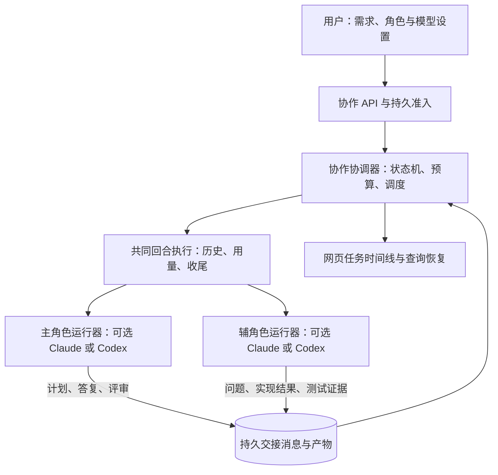

# 多 Agent 协作任务设计

[文档导航](../README.md) · [实施计划](../milestones/collaboration.md) · [账号与模型](../accounts-and-models.md) · [聊天回执](../chat-protocol.md)

状态：设计草案，C1 基础协议与存储实施中，入口尚未开放。日期：2026-10-11。起始代码基线：`fa170409`。本文描述目标设计，实际完成范围及证据以[实施记录](../milestones/collaboration.md)为准，不能作为当前 API 使用说明。

## 1. 目标与核心决策

用户提交一个任务，自行选择主 Agent、辅 Agent 及各自账号、模型、推理强度。主 Agent 负责规划、答疑与评审，辅 Agent 负责实现、测试与反馈；双方通过 agentbox 传递任务和问题，自动推进到交付结果或明确的待处理状态。

**职责、Agent 类型、账号与模型分别建模。主 Agent 不固定为 Claude Code，辅 Agent 不固定为 Codex。** 首期支持以下四种组合，两个角色也可以选择同一类型的不同模型：

| 主 Agent | 辅 Agent | 支持范围 |
| --- | --- | --- |
| Claude Code | Codex | 主方规划评审，辅方实现测试 |
| Codex | Claude Code | 同一流程，职责随角色改变 |
| Claude Code | Claude Code | 独立上下文；可用相同或不同账号、模型 |
| Codex | Codex | 独立上下文；可用相同或不同账号、模型 |

核心决策：

1. 服务端持有流程控制权，模型提出计划、问题和结果；数据库状态决定能否执行下一步。
2. 首期固定两个角色、串行交接，一个任务同一时刻最多一个模型回合。协作不要求两个 CLI 常驻运行。
3. 两个角色各有独立执行环境、凭证和 provider 线程；共享明确的任务材料，不互相复制原生对话文件。
4. 辅 Agent 独占任务代码写入，主 Agent 读取不可变快照。首次交付保留在任务副本，应用回原项目是独立动作。
5. 每次交接持久化，执行步骤有独立准入和回执；网络重试、页面刷新、服务重启不能触发重复执行。
6. 用户可以交换主辅、替换账号与模型；执行中的修改在安全边界生效，并建立可审计的新配置版本。

## 2. 首期范围与交付语义

首期完整路径：创建任务 → 主方规划 → 辅方执行 → 辅方提问/主方答复 → 主方评审 → 有限返工 → 交付。

支持：角色配置、计划预览、自动交接、用户答疑、暂停/继续/取消、配置变更、刷新恢复、代码差异和测试证据、分角色用量、失败核对。默认用户查看计划后点击执行；创建时可明确选择“规划后自动执行”，该选择进入任务记录。

`completed` 表示指定结果快照通过主方评审，并满足该任务要求的验证及结算条件；不表示已经合并、推送、部署，也不证明代码没有缺陷。界面应显示“评审通过，结果待应用”。

首期项目输入限定为用户有权访问的、**干净的普通 Git 仓库及其明确提交**。预检拒绝未提交变更、待纳入的未跟踪文件、submodule、LFS 占位文件和仓库外部依赖，展示原因，不替用户提交、stash 或删除。这样可以先确保双方看到同一基线；未提交项目的完整快照导入另列后续阶段，不隐式漏掉用户文件。被忽略的构建缓存不进入基线，所需依赖在任务环境重建。

首期不做任意人数团队、并行写代码、跨用户协作、无限递归委派、自动合并/推送/部署、任意时刻热替换运行中的模型。主方默认兼任评审者，不宣称独立第三方审计。

## 3. 现有结构与复用边界

| 当前代码 | 现状 | 协作所需变化 |
| --- | --- | --- |
| `internal/store/store.go` 的 `Session` | 一个 Agent、账号、当前 provider 续聊 ID | 保留单 Agent 语义；新增协作任务和参与者关联 |
| `internal/server/chat.go` 的 `chatRoom` | 每空间单回合、广播与房间锁 | 保留；协作另有任务准入，受管参与者不能从普通聊天入口抢占 |
| `internal/chat/service.go` | 执行编排、历史、用量、回执收尾 | 提取共同回合运行接口，支持普通聊天和协作步骤两个调用方 |
| `internal/chat/executor.go` | Claude 单回合 stream-json；Codex app-server，有限回退 | 复用传输；增加协作所需的严格恢复和最终答复提取 |
| `internal/agent/adapter.go` | 统一事件与结束信号，能力描述较少 | 增加最终答复、严格恢复、交接输出等可验证能力 |
| `internal/server/chat_receipt_turn.go` | 用量与转录收尾后确认回执 | 保留顺序，抽取可复用收尾机制；协作使用自己的步骤回执 |
| `internal/workspace` / `internal/dockerx` | 生命周期、home、固定 workspace/shared 挂载 | 增加受服务控制的协作运行配置和挂载配置 |
| `internal/usage` / `internal/store/usage_messages.go` | 用量归一化、消息去重、同事务扣款 | 沿用原结算，建立步骤与 turn_id 关联，不另算一份账 |
| `internal/server/mcp.go` | 网页 MCP 管理目前限 Claude | 不作为首期通信前提，后续再提供协作 MCP |

现有 `chat.Service.Run` 不授予调度权，不能从模型事件回调里直接递归调用另一个回合。协作协调器必须先取得自己的持久执行资格，再进入共同执行路径。

M11 的“多 Agent 接入”负责增加 CLI 类型，本专项负责让已接入类型协作。首期只依赖 Claude/Codex 的能力适配，不等待 Kimi 等新类型接入，也不把完整 Provider 注册表重构当作开工条件。

## 4. 角色、配置与运行中更换

### 4.1 配置模型

`coordinator` 对应主 Agent，拥有规划、回答执行问题、发起评审和提出返工的职责；`executor` 对应辅 Agent，拥有任务副本的代码写入、测试、提问和结果提交职责。

每个角色绑定：`agent_type`、`account_id`、`model`、`effort`、`effort_control`。服务端校验账号类型与 Agent 类型一致，用户有权使用账号，模型和推理档位符合该账号当前能力。

界面按“Agent 类型 → 账号 → 模型 → 推理强度”选择。账号模型限制、显示/隐藏规则、能力优先级和默认强度复用现有账号/聊天逻辑；切换类型后重新选择兼容账号与模型，不能把原模型字符串直接搬过去。账号允许自定义模型时保留输入能力，不把官方模型建议误当成硬白名单。

任务创建时解析默认值并冻结为具体配置。管理员后来修改全局默认模型不能改变在途任务；撤权、模型被移出允许列表或能力变更时暂停新步骤并要求重新配置，不能悄悄换模型继续。隐藏只影响下拉展示，已选且仍获授权的隐藏模型仍可显示和使用。

### 4.2 交换与替换

| 时机 | 行为 |
| --- | --- |
| 创建前 | 自由修改；“交换主辅”交换整套 Agent/账号/模型/强度配置 |
| 已创建、未开始 | CAS 更新任务配置版本，重新预检 |
| 等待用户或已暂停，且无运行进程 | 保存新配置版本，准备新参与者上下文后继续 |
| 模型正在执行 | 记录“本步结束后暂停”；到达边界后才能修改配置；需要立即停止则走中断及核对流程 |
| 结果不明或旧进程尚未停止 | 禁止交出写权限或换配置启动新步骤，先处理 `uncertain` |
| 已完成/已取消 | 不改历史；以原结果或基线创建后续任务 |

每次角色绑定变化创建新的参与者代际 `generation`，保留旧配置、线程和费用。首期即使只改模型也新建 provider 线程，避免依赖各 CLI 不一致的跨模型恢复行为。新参与者通过交接材料获取需求、已确认计划、决策、问题、代码快照和未完成项；界面明确提示“原生上下文已重建”。不得宣称跨 Agent 转移完整记忆。

交换主辅时，角色职责保持不变，新的辅方接管任务工作副本，新的主方获得只读快照；旧辅方进程和容器必须先停止并确认。任务中途换主方后先安排一次计划/结果复核，不把前任的评审授权自动移交为完成。

同一账号可以绑定两个角色，但 home 与 provider 线程必须独立，OAuth 同步继续按账号锁串行。角色权限按运行配置决定，不能因“主 Agent”称谓获得管理员或其他用户权限。

## 5. 架构与执行闭环



首期调度顺序：

1. 用户提交需求与配置，服务端冻结输入、接受创建请求，准备独立基线和参与者。
2. 主方读取基线，返回计划、约束、验收项；有产品歧义时向用户提问。
3. 计划通过所选确认策略后，服务端创建辅方步骤，输入计划和代码基线。
4. 辅方完成一个回合，输出实现结果或问题；提问会结束本回合，停止其容器并发布当前代码快照后交给主方，不同步阻塞等待主方。主方答疑可以读取提问时的实际代码。
5. 主方收到问题，给出答复或转交用户；答复被记录后辅方恢复自己的上下文继续。
6. 辅方报告实现完成后，停止其容器及残留进程，再发布结果快照和差异；按任务约定执行验证步骤。
7. 主方评审该快照及证据，返回通过、具体返工项或待用户决定事项。评审必须引用结果快照和计划版本。
8. 返工开启新的辅方步骤；通过后满足最终收尾条件才完成任务。到轮数、时间、费用边界则暂停。

一个任务内部串行；不同任务受实例/用户容器数与调度并发上限约束。只有实际运行步骤持有 activity 引用；等待用户不长期占用运行槽。首期角色交接必须停止前一角色容器并核对状态，因此实例仅允许一个运行容器时也能协作，也不会遗留上一角色的后台写入。

调度器持有短期锁处理状态，不在 SQLite 事务、账号锁或房间锁内等待模型、Docker 或其他 Agent。后台任务接入现有 `spawn` / `workContext` 生命周期。

## 6. 交接协议与上下文

### 6.1 传递内容

每条共享消息含服务端分配的 `message_id`、`run_id`、`step_id`、`seq`、发送/接收角色、配置版本、计划版本、回复对象和创建时间。模型仅填写业务内容；服务端从当前执行身份生成可信信封，模型不能声明自己来自用户或另一个角色。

| 类型 | 核心内容 | 路由 |
| --- | --- | --- |
| `plan` | 目标、实施项、依赖、范围、验收项、需用户决定项 | 主方 → 服务端 → 用户/辅方 |
| `question` | 具体问题、当前阻塞点、可选解释、相关材料 | 辅方 → 主方；主方也可 → 用户 |
| `answer` | 回复的问题 ID、决定、适用范围与依据 | 主方/用户 → 对应等待步骤 |
| `result` | 完成项、剩余项、测试声明、服务端产物引用 | 辅方 → 主方 |
| `review` | `approve` / `revise` / `needs_user`，逐项结论与返工要求 | 主方 → 服务端 |

以下为模型业务输出示例，外层身份字段由服务端补充：

```json
{
  "version": 1,
  "type": "question",
  "payload": {
    "text": "遇到已存在的账号时应跳过还是更新？",
    "options": ["跳过并统计", "更新允许修改的字段"],
    "blocking": true,
    "context_refs": ["plan-item-2"]
  }
}
```

回复必须指向仍待答的原问题；重复回复按动作 ID 去重，过期配置/计划的迟到回复不能推进新步骤。计划修改新增版本，辅方下一步重新绑定；旧结果不能直接用于通过新版计划。

### 6.2 第一版如何取得结构化输出

先让每个 Agent 在**最终答复**中返回一个符合交接 schema 的 JSON 对象；过程中自然语言与工具事件仍可流式展示。Adapter 从 provider 的完整最终答复中提取，不能从任意 stdout、工具输出或增量文字里匹配花括号。

第一版每回合只接受一份终结交接对象，限制 64 KiB、已知字段、列表长度及引用数量。模型输出的路径只是声明，不能成为宿主文件读取地址或 shell 参数。协议示例和解析样本必须使用合成数据。

输出缺失、格式无效或引用不存在时，保留已发生的代码变更和费用，记录 `handoff_invalid` 并暂停；不因 JSON 错误自动重跑修改任务。用户可显式安排新的“补充交接”步骤，使用现存结果，费用正常计入。同一回合只能采用经 CLI 能力探测确认的 schema 约束选项；未验证的 CLI 参数不得成为前置假设。

### 6.3 上下文编排

输入由固定角色指令、用户原始需求、最新确认计划、有效决策、待答问题、代码/产物引用及必要最近交接组成。用户内容、项目文档和其他 Agent 消息分区标识，不能提升为服务端指令。

双方原生历史分别保留。共享上下文有大小预算，长测试日志通过有界摘要及可读取产物提供，裁剪必须显示标记。首期用结构化材料拼装，不额外调用模型生成隐藏摘要；未来增加摘要回合也必须单独记录来源、版本和费用。

## 7. 数据模型、幂等与状态机

拟新增下列表；实际 SQL 迁移编号由实施时当前 schema 顺延，本文不预占版本号。

| 实体 | 主要字段 / 不变量 |
| --- | --- |
| `collaboration_runs` | owner 与用户创建身份、创建 request_id/fingerprint、源空间/仓库/基线、状态、revision、配置版本、计划版本、预算、取消/暂停标记 |
| `collaboration_configs` | run_id + version 唯一；两角色完整绑定、执行确认策略与限额，不保存账号密钥副本 |
| `collaboration_participants` | run_id、role、generation、配置版本、受管 session_id；每代绑定不可变，原生线程归该参与者 |
| `collaboration_steps` | step_id、run_id、kind、participant、input fingerprint、attempt、turn_id、state、revision、执行代际、快照引用、终结/历史/结算状态 |
| `collaboration_messages` | run_id + seq 单调唯一、step_id、消息类型、回复对象、配置/计划版本、有界正文 |
| `collaboration_artifacts` | 服务端生成 ID、run/step、类型、相对存储键、摘要/长度、快照清单、发布状态；不接受任意宿主路径 |
| `collaboration_actions` | owner + run + 客户端 action_id 唯一；冻结输入和返回结果，处理确认/回复/配置/暂停/恢复/取消/核对的重放 |
| `collaboration_events` | run_id + seq、有界版本化事件；状态变更与事件同事务提交，供网页恢复 |

步骤 kind 区分 `plan` / `execute` / `clarify` / `review` / `repair` / `verify` / `handoff_repair`。其中 `verify` 可为受控容器测试命令，不要求调用模型。

任务状态：

```text
accepted → preparing → planning → awaiting_plan → executing → reviewing → completed
                           │                         ↑           │
                           └─ 自动执行可跳过确认 ──────┘           └─ 返工 → executing

活动阶段 ↔ waiting_answer / waiting_user
活动阶段 → pausing → paused → 恢复原阶段
活动阶段 → cancelling → cancelled
准备失败 → failed
可能已执行且结果不明 → uncertain → 显式核对后的 paused 或终止
```

任务另存 `phase` 与 `wait_reason`，使“暂停在评审”“等待资源”“等待用户答疑”可区分。自动执行只是跳过 `awaiting_plan`，不能跳过权限、范围和预算检查。

模型步骤状态：`accepted → starting → running → finalizing → completed`，异常可进入 `failed` / `interrupted` / `uncertain`。模型步骤 `completed` 只证明该回合正常收尾；交接校验失败时父任务仍暂停，不能显示任务成功。

### 7.1 准入和派发

1. 创建、动作提交均以身份范围和固定 ID 幂等接收。相同 ID/相同输入返回原结果，不派发；输入不同返回 409。
2. 处理有效交接时，同一事务写消息、推进父任务 revision、创建唯一下一步骤；唯一键防止两个协调器各建一份步骤。
3. 在模型启动之前通过 CAS 认领步骤，持久登记执行代际和 `running`。事务失败不得调用 CLI；认领成功也不能把外部执行视为可事务回滚。
4. 迟到输出只可由仍拥有该代际的执行者推进。旧执行者不能覆盖暂停、取消、核对或配置替换后的状态。
5. 持久最终结果、历史同步、原用量结算、有效交接及必要产物发布完成后，才授予后续步骤执行资格。任一环节不明就阻断后续。

不把内部调度伪装为用户给普通 `/chat/requests` 发送消息。普通聊天协议与协作协议使用独立 scope/回执；共同执行器只消费已经得到准入的冻结输入。

### 7.2 重启、恢复和取消

启动在 Docker 初始化前围住残留活动步骤。`starting/running/finalizing` 进入 `uncertain`；尚未派发的 `accepted` 及已确认交接后的待执行步骤进入暂停，首期服务重启后不自动继续调用付费模型。

恢复先查询回执、实际容器和结果；CLI 已启动但服务端未获确认时，文件和网络副作用可能已发生。数据库幂等不等于外部命令恰好执行一次。

Codex 当前 `thread/resume` 失败会新开线程；协作步骤必须开启严格恢复：恢复失败暂停，显式重建上下文后使用新步骤。Claude 路径也应验证恢复结果。回合可能已提交后不得换 transport、换模型或新 ID 自动补跑。

暂停默认等待当前步骤收尾再停；立即停止走取消/中断。取消先持久置位，阻止下一步，再向当前执行者发中断。确认进程停止后才能标 `cancelled` 或让新执行者取得写权限；未确认保留 `uncertain`。容器内后台子进程不能靠 CLI stdout EOF 判定已结束，必要时停止该任务专属容器。取消不回滚代码、外部副作用或已发生费用。

人工核对只解除不确定性阻塞，不把旧步骤篡改为成功。继续工作创建新步骤，引用已核对的结果快照，并保持旧执行 ID 围栏。

## 8. 工作副本、隔离与产物

拟议布局（所有任务正文与产物都位于该用户的持久数据配额内）：

```text
data/users/<user>/
  collaborations/<run>/
    baseline/                 服务端发布的不可变代码基线
    work/                     当前辅角色唯一可写项目副本
    snapshots/<artifact>/     停止写入后发布的评审快照
    artifacts/<artifact>/     差异、验证输出、交付清单
    inputs/                   已校验附件，只读提供给参与者
    scratch/<participant>/    参与者独立临时文件，对应其 /shared
    staging/                  服务端私有暂存，不挂入容器
  sessions/<participant>/
    home/                     该参与者独立凭证与原生历史
    chats/                    该参与者执行转录
```

受管 Session 保留生命周期、账号授权、凭证同步和用量归属。用显式 `purpose/managed_by` 元数据标记，普通空间列表默认不混入内部参与者；容器监控、容量计数、清理、备份、账号撤权与用量扫描必须覆盖它们。所有 REST/WS 入口都要服务端限制：受管参与者不能被普通聊天、终端、文件写入、账号切换或空间删除接口绕过调度器操作。

原项目选定提交通过隔离容器内 Git 导出，并在任务环境构建独立仓库；沿用 `gitx` 的 argv、环境、超时和受限目录规则，禁止宿主 Git 降级。任务仓库不依赖源仓库的 `.git`、worktree 指针、alternates 或硬链接；不导入源仓库 hooks、凭证 helper 和远端写授权。准备失败不能修改原项目。

主方 `/workspace` 挂载当前不可变快照且只读；辅方 `/workspace` 挂载 `work` 且可写。各自 home 可写。两方 `/shared` 分别挂载任务内各角色的私有临时区，首期不挂普通用户共享目录，也不直接共享可写目录，避免从别名路径接触原项目或对方文件。附件先通过属主验证，再复制到任务拥有的只读输入区分别挂载。公共工具只读；协作私有缓存按任务/角色隔离且计入用户缓存限额，避免主方通过共享可写缓存干预辅方构建。

协作 profile 默认不自动应用用户/全站的 MCP、rc 和技能模板；需要的扩展在任务预检中显式选择并记录，首期仅启用验证过的内置配置。凭证依旧按账号单独播种，账号 env 只在本角色 exec 时注入。不能把两个账号的凭证写进同一 home。

账号配置和仓库内配置也可能声明 MCP、hooks 或额外目录权限；运行配置应在保留必要 provider/登录设置的同时约束这些继承项，不能只跳过 home 模板就称已隔离。只修改受管副本，不改账号池和源项目；CLI 无法可靠实现某项限制时，在探针中记录并拒绝启用依赖该限制的配置。

切换到评审前停止辅方容器，确认 Docker 状态和无其他任务容器写挂载后，固定目录句柄生成快照、文件摘要和差异。新文件、删除、二进制变化及文件模式均进入清单；不跟随符号链接，不接受外部/绝对链接或特殊文件，超出数量/容量上限暂停。原子发布并同步后再登记 artifact 为 ready；发布后不得写入。数据库与文件不是一个事务，恢复时检查暂存、摘要和发布状态，不能把半份快照交给主方。

首期提供完整结果归档、相对基线的变更包和文件清单下载。应用回原空间另走未来的预览/确认/CAS 接口，核对目标基线及当前变更；首期不自动写回用户项目。后续任务可以选已完成快照为输入。

## 9. 验证证据、权限与费用

### 9.1 结果证据

区分“Agent 声称测试通过”和“平台记录的验证结果”。Agent 工具输出可展示，但不能自动升级为可信验收。

任务计划列出验收项；用户确认验证配置，或使用创建时明确授权的项目验证配置。服务端在任务隔离容器内执行对应命令，记录配置来源、argv、工作目录、退出码、耗时、输出截断标记和代码快照。不得在宿主执行模型给出的命令；项目脚本仍是不可信代码，沿用容器权限、资源和网络边界。

运行验证可能修改项目或启动后台进程，结束后停止验证容器并重新比对代码清单。代码变化必须重新发布快照、使旧验证证据失效；C1 预先列明的新增构建输出目录为 build、dist、out、target、coverage、.cache；目录内已有路径仍必须保持相同，不能隐藏源码变化。主方评审与必需验证必须指向同一份最终代码快照，必需验证失败/缺失时主方不能单独宣布通过。

### 9.2 授权与资源边界

用户授权对象是“在所选项目副本及指定角色配置下完成任务”。主方提出的命令、账号、更大范围、额外角色和预算都不自动扩大授权。新步骤运行前复核用户身份、账号授权、模型允许范围、容器/磁盘限额和任务预算。

首次启动准备两个参与者并不是同时占用两个运行名额；历史代际与快照会增长，必须有任务磁盘预算、用户配额及显式删除路径。空间不足时保留已确认结果并停止派发，不能清理原项目或其他任务来腾空间。

首期不授予 Git push、部署、宿主命令或其他用户访问能力。任务内容可以随两角色输入传给其配置的上游，创建页面明确列出两套 Agent/账号。只读挂载只能保证该代码视图不能写，不能证明模型无任何网络副作用；现有模型账号出口不是通用网络沙箱。若任务要求严格限制远端副作用，必须增加可验证的网络/工具策略后才允许该模式，不能靠角色提示词承诺隔离。首期延续个人自托管/可信小团队边界。

### 9.3 用量和预算

每个模型步骤的稳定 `turn_id` 对应现有 `usage_events`，参与者 Session 保留 agent/account/model 归属。首期保留现有 `kind=chat` 和 Claude `usage_messages` 去重入口，通过协作步骤关联查询角色/任务，不为了新增分类绕过只接受 chat 的原去重结算逻辑。自动标题关闭；未来额外摘要、格式修复等模型调用必须记成显式步骤。

仍由现有用量写入/消息认领/额度扣除事务结算，任务只聚合已有行。包括失败、中断、提问、评审、返工和替换前参与者的实际用量。终端扫描必须识别这些受管回合，避免重复显示或补扣。

分别设置最大返工次数（建议默认 2）、最大模型步骤数（建议 20，包含答疑）、单步超时、累计执行时长、用户等待到期时间和可选费用预算。达到上限暂停，用户显式提高限额后继续；重复问题也占步骤预算，避免答疑绕过返工限制。

费用预算按结算后决定是否派发下一步；当前在途回合仍可能超支，不能称硬消费上限。没有可靠价格或用量时标为未计价/不完整；配置了费用预算的任务暂停后续自动执行，不能把未知费用按零放行。用户账户总额度仍独立生效。

## 10. 拟议 HTTP 协议与网页

独立能力 `collaboration_protocol:1` 和身份范围 `collaboration_scope`，不复用 `chat_protocol`。显式未知版本禁止提交，不能降级成普通聊天。下列路径仅为设计，全部需要登录、任务属主及用户创建身份校验；写请求只接受 Authorization 头。

| 接口 | 语义 |
| --- | --- |
| `POST /api/collaboration/preflight` | 无模型调用地检查源项目、角色/模型、镜像能力、空间和验证配置；结果不替代提交时复查 |
| `PUT /api/collaboration/runs/{request_id}` | 按 scope/请求 ID 幂等创建；冻结需求、源基线、角色配置、确认策略和预算 |
| `PUT /api/collaboration/requests/{request_id}/abandon` | 对尚未接受的创建请求写入永久围栏；已经接受则返回冲突及原任务，不伪装取消 |
| `GET /api/collaboration/runs` | 当前用户任务列表，分页；内部参与者不作为普通空间重复列出 |
| `GET /api/collaboration/runs/{id}` | 权威状态、revision、当前配置、待答问题、费用与可用动作 |
| `GET /api/collaboration/runs/{id}/events?after=<seq>` | 持久事件分页恢复；游标过期返回需重新读取快照的明确状态 |
| `GET /api/collaboration/runs/{id}/stream` | WS 实时事件与文字增量；支持现有受限 WS 鉴权方式，不承担确认责任 |
| `PUT /api/collaboration/runs/{id}/actions/{action_id}` | 带 scope、expected_revision 的确认计划/答复/暂停/继续/取消/配置变更/核对动作 |
| `GET /api/collaboration/runs/{id}/actions/{action_id}` | 查询丢失响应的动作结果，不重做动作 |
| `PUT /api/collaboration/runs/{id}/actions/{action_id}/abandon` | 围住尚未接受的动作 ID；已接受动作须查询原结果或提交后续动作 |
| `GET /api/collaboration/runs/{id}/artifacts/{artifact_id}` | 属主范围内查看/下载服务端登记的产物 |
| `DELETE /api/collaboration/runs/{id}` | C1 带 scope/expected_revision，只接受静止任务（运行中先暂停/取消，未知回合先核对）；先持久化删除围栏，再清正文/文件，清理失败可重试 |

动作先查相同 ID 的原结果，再检查新动作的 revision/权限；重新配置只影响后续新步骤。提交响应区分已接收和完成。未知请求 ID 放弃也需要持久围栏，防止迟到创建/动作；删除任务先取消并确认停止，再清正文、撤销产物访问并保留 ID 围栏。

创建请求 ID、动作 ID 均由客户端生成并在首次提交前保存，首期采用现有 32 位小写十六进制格式。创建请求 ID 同时作为该身份范围内的公开任务 ID，因此丢失创建响应时可直接 `GET /runs/{request_id}`；服务端始终联合校验属主及创建身份，不把 ID 当作访问凭据。404 后只能查询、按原 ID/原内容重试或写放弃围栏，不能换 ID 自动重建任务。

网页创建页提供两个完全对称的配置区及“交换主辅”；职责说明固定随角色，不随品牌。选择账号后加载其模型能力，不继承另一角色的强度。可以记住个人上次选择，但不得把密钥或过期授权当作有效配置；暂不增加可分享的团队模板。

任务页显示目标、当前阶段、两角色当前模型、配置变更记录、双方消息时间线、待用户问题、代码差异、测试证据及费用。自然语言进度和可靠步骤状态分开呈现；增量未持久化时刷新可丢失暂态文字，但最终交接与回执不能丢失。

页面刷新、切空间、退出和多标签页沿用现有身份代际原则：重连只查询，动作按原 ID/冻结输入恢复；迟到事件必须核对 run_id、scope、配置版本和 seq，不能改写新任务。保留键盘焦点和滚动位置，三语/窄屏下显示完整阻断原因，不能只靠角色颜色区分发送方。

## 11. 模块拆分、兼容与备份

建议新增 `internal/collaboration` 管理状态机、输入编排、调度与结果判定；通过窄接口依赖 store、共同回合运行器、workspace 与产物服务，不直接依赖 HTTP Handler。server 负责授权、API、WS 和生命周期适配。前端新增 `web/src/features/collaboration/`，契约放入 `contracts/` 并生成对应 TS 类型。

`internal/chat` 的拆分先保证普通聊天行为不变，再接协作步骤。不要复制一套 usage tally、凭证刷新或历史同步代码，也不要重用普通聊天的用户输入记录来冒充 Agent 间交接。

部署默认关闭协作入口；服务端协议可用、所选角色对应 CLI 的能力验证通过后才允许创建。包含 Codex 的组合要求 app-server 能力实测；协作不开放未经验证的 exec 回退，普通聊天保持原行为。未选用的 Agent 不可用不能阻断其他已验证组合。角色对称性由业务层保证，不假装两个 transport 支持相同扩展。

新增表、Session 受管标记、用量关联和 schema 版本在同一版本迁移中发布。旧二进制不得打开新 schema；发布前补兼容矩阵、升级和恢复演练。已有普通空间、聊天 v1 和桌面项目协议维持原行为；不支持协作的旧客户端只能使用普通能力，不能访问受管参与者的写入口。

系统备份包含配置、任务元数据/交接正文、回执、凭证和清单；项目副本、快照、实际产物和附件需要 full 备份。仅恢复系统备份时标记 `artifacts_missing`，禁止继续执行或显示可交付文件。完整恢复重新核对摘要、参与者关联和身份范围，所有未结束任务先暂停/待核实，绝不自动调用模型。

正文清理涵盖任务、动作、共享消息、事件、参与者转录和产物；保留必要 ID 围栏、费用流水和不含正文的审计。旧备份和 SQLite 空闲页不提供物理擦除保证。有效任务与待核对任务保护附件/产物引用，引用扫描失败时拒绝 TTL 删除。

## 12. 分阶段验收与未决项

实施顺序及逐项验收见[协作专项 C1～C3](../milestones/collaboration.md)。首期发布必须覆盖四种角色组合、同类型不同模型、交换主辅、运行中换配置、账号撤权、进程停止证明、重复交接、重启、预算、用量和产物完整性，不能只演示正常流程。

进入编码前的技术探针：

- 以选定镜像中实际 CLI 版本核对最终答复提取、严格恢复、中断及结构化输出可用性。无法保证这些能力的组合在 UI 标记不可用，不临时放宽结束判定。
- 验证只读项目下两种 CLI 均能在独立 home 正常续聊；受管 profile 对模板/MCP/共享工具和账号出口的影响。
- 量测私有副本和快照的容量、耗时，确定默认文件/字节上限及并发槽；数字以样本定，不在设计阶段承诺性能。
- 确定验证配置的首期内置模板及授权呈现；未指定必需验证项时明确显示“仅模型评审”，不能宣传为测试通过。

上述为实现调查项，不改变已确定的角色可配置要求。默认双角色串行、计划确认、有限返工、新配置新上下文是首期产品决策；扩大为并行团队另立范围。

## 13. 依据

- 本文基于 `fa170409` 的 Session、chat Runtime/Executor/receipt、workspace 生命周期、account_models、reasoning、usage 去重结算、MCP 和 safefs 实现，及现有[聊天协议](../chat-protocol.md)、[数据库迁移](database-migrations.md)、[文件边界](filesystem-boundaries.md)。
- OpenAI Docs：[Codex App Server](https://developers.openai.com/codex/app-server)，2026-10-11 查阅。官方线程/回合/中断机制可作为 Codex 传输基础；本文不依赖实时 steer 或实验性动态工具。当前文档与安装版本可能不同，实际能力必须通过候选镜像探针。
- Claude 侧首期依据仓库已有 stream-json 接入；本文不声称现有适配器已支持双向常驻通信或 schema 约束。相关能力通过探针确认后再确定参数。


### C1 开发实现补充（2026-10-11）

当前页面实时输出采用 Bearer 鉴权的 SSE；事件时间线和参与者转录独立持久化并分页查询。流丢失不会触发模型重跑。任务默认单步 30 分钟、累计模型步骤 6 小时、等待用户 7 天；等待只暂停，崩溃回合按单步配置时限计入执行预算，核对/等待时间不重复累计。

用户核对异常回合前，服务停止并核验容器，再发布 `inspection` 快照。它可与原基线比较和单独下载，但不能作为结果交接或完成任务的依据。交接格式错误使用 `handoff_repair`：原参与者续聊、只读当前快照、仅纠正结构，计入模型步骤和原用量结算，不再次赋予项目写权限。

验证完成后先将匹配 snapshot/config 的平台证据冻结进 review，再检查模型决定。验证失败允许有限返工；只有同快照的成功验证（或明确 not_requested）与评审通过同时成立才进入交付。删除只处理静止任务，保留 ID/费用围栏；清理未完成的 tombstone 保留在任务列表，避免丢失重试入口。
