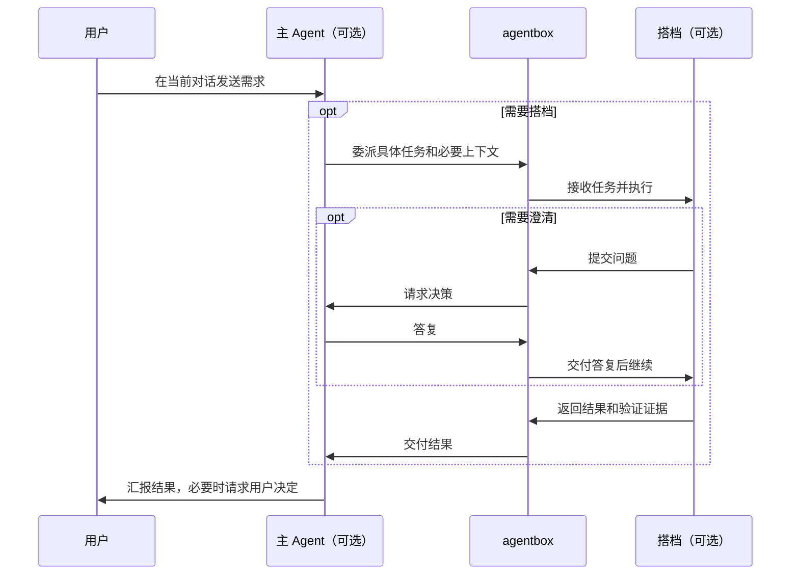

# 多 Agent 协作减重调研与建议

调研日期：2026-10-11。状态：研究与待实施建议；不代表生产已经改为下述模式。

2026-10-12 实施更新：生产开发预览 `.15` 已接入显式直接执行、协作复核的评审差异/代码地图与增量交接，见[协作减重实施](../milestones/collaboration-lightweight-20261012.md)。下文的自由委派工具桥和动态子任务仍为后续设计；本轮发布与核验见实施记录。

本次读取当前仓库实现，并通过 GitHub 搜索、官方 README、文档和关键源码核对参考项目。没有运行这些项目、调用付费模型或做耗时对比。上游能力与维护状态只代表本次核查版本；不以星数或宣传中的效率倍数作为可靠性证据。

## 1. 结论

默认协作应采用“一个主 Agent 持续面向用户，按需委派搭档”。同一个空间、同一个输入框，发送前选择普通对话或协作；主方和搭档都可选择 Claude Code / Codex 及各自账号、模型、强度。主辅表示本次分工，不与产品品牌绑定。

保留已有可靠接收、费用结算、权限、文件隔离和恢复能力。把固定的规划、确认、实施、验证、评审、应用流程收为高级执行策略。优先参考 Goose 的按需委派、CCB 的异构消息路由、Aider 的简单接力；用 MCP Agent Mail 的消息身份和收件状态补齐通信语义。

减重的目标是减少必经阶段、重复上下文和人工操作。一次“主方委派 → 搭档执行 → 主方汇总”仍可能需要三个模型回合，不能保证一定比当前流程快。收益需要按实际模型回合数、输入量、准备耗时和人工等待测量。

进一步的[自动选模与按需协作方案](collaboration-model-routing.md)引入 Jev 类决策器的思想：在用户允许的候选内，分别决定模型、推理强度和是否委派；简单任务可直接由经济模型完成，复杂任务直接用强能力模型，已确认但不满足要求的结果允许有界升级。该补充仍为待实施设计。

用户已确认的插件执行流程和首期开发约定集中在[可插拔决策插件设计](decision-plugins.md)：主辅分别固定或自动、规则优先、Jev 可选、故障采用冻结回退、执行绑定冻结后不再选模。本文对后续分工与并行的建议不扩大插件首期范围。

## 2. 当前产品如何操作

1. 在空间对话输入框选择“多 Agent 协作”；团队摘要中可交换主辅，分别设置账号、模型、强度。
2. 输入需求并发送。来源需要符合当前导入规则的干净 Git 仓库，系统建立独立任务副本；可携带当前线程的有界可见上下文。
3. 主方规划，默认等待用户确认；打开“规划后自动执行”可跳过该确认，但仍会调用主方规划。
4. 辅方实施；遇到问题先问主方，主方必要时转问用户。补充要求在步骤收尾后纳入，随后重新规划。
5. 有用户配置的验证命令时执行平台验证，再由主方评审，必要时有限返工。没有验证命令时明确显示“仅模型评审”。
6. 评审通过后查看差异，停止源空间，再显式应用到当前项目。完成任务与文件已经应用是两件事。

当前协作属于平台中转的真实问答与交接。双方输出 `plan / question / answer / result / review` JSON，服务端存储消息，再组装下一步输入；各自保有独立原生线程，不交换 Claude/Codex 的 provider 会话 ID。

它目前只有两个角色、串行执行。主方只读并承担规划/答疑/评审，辅方修改文件；计划条目不是可独立调度的子任务。画布显示固定阶段，不是任意并行执行图。

证据：[使用说明](../collaboration-preview.md)、[提示词](../../internal/collaboration/prompt.go)、[交接调度](../../internal/store/collaboration_handoff.go)、[单活动步骤索引](../../internal/store/migrations/013_collaborations.sql)、[结果应用](../../internal/server/collaboration_apply.go)。

## 3. 为什么会感觉长、重

| 已核对的实现 | 用户感受及影响 |
| --- | --- |
| 每个正常完成的任务至少规划、实施、评审三个模型回合 | 小改动也走完整流程；自动确认只能减少点击 |
| 最终答案必须严格符合交接 JSON | 格式不符会暂停，用户需要理解“修复交接格式” |
| 每步重新拼入该任务全部结构化交接记录 | 问答/返工越多输入越长；同时使用原生续聊，有重复上下文风险，尚未实测费用影响 |
| 每个模型步骤结束后确认进程停止、结算，再安排下一步 | 有生命周期与快照开销；这也是现有文件一致性保证，不能直接删除 |
| 补充要求更新配置代际、重新准备和规划 | 一句增量反馈也容易变成流程重启 |
| 导入独立副本，最后另行应用 | 聊天入口统一了，文件交付仍有额外操作 |
| 自动验证/交付的内部状态也使用 `paused` | 当前聊天任务标题直接映射 state，可能将正常后台处理短暂显示为“已暂停” |

代码入口：[步骤执行](../../internal/server/collaboration_execute.go)、[上下文与交接](../../internal/store/collaboration_handoff.go)、[补充要求](../../internal/store/collaboration_supplements.go)、[任务标题和按钮](../../web/src/features/collaboration/composer.ts)。

## 4. GitHub 项目比较

| 项目 | 核实的机制 | 建议借鉴 | 边界 |
| --- | --- | --- | --- |
| [CCB / claude_codex_bridge](https://github.com/SeemSeam/claude_codex_bridge) | Claude/Codex 等 CLI 之间通过 `ask` 请求、`back` 返回；每个目标有 FIFO 队列和交付状态；支持分别配置 provider/model | Agent 可以请求另一个 Agent 帮忙；请求与返回进入同一有序通信链；保留各自原生上下文 | 其原生终端投递依赖输入状态识别，README 说明并发输入和部分 provider 的保护限制；agentbox 应复用受控 CLI 传输，不照搬模拟粘贴/回车 |
| [Goose](https://github.com/block/goose) | 主 Agent 按需调用 `delegate`；子上下文隔离，指定 provider/model/context，结果回主 Agent；界面折叠子任务 | 不预先给每个任务安排完整流程；只给助手所需材料，主对话突出结果 | 源码明确 delegates 不能互相协调，不能把它说成自由群聊；外部 Codex MCP 是文档示例，不是本项目已验证集成 |
| [Aider](https://github.com/Aider-AI/aider) | `/architect` 可只作用于一条消息；Architect 输出交给 Editor，两个模型独立配置，可自动接受交接 | 一条需求、简单接力；模式属于当前对话；按任务决定是否需要双模型 | 是 Aider 内部双模型模式，不是 Claude Code/Codex CLI 混编运行时；两次调用会增加时间与费用 |
| [MCP Agent Mail](https://github.com/Dicklesworthstone/mcp_agent_mail) | Agent 身份、线程、发送/收件/确认、持久消息记录、文件预约 | 通信与任务执行分开；只拉取必要或未读消息；明确发送者、接收者和交付状态 | 是通信层，不负责完整执行调度；文件预约是 advisory，不能替代容器和文件写权限隔离 |
| [Agent Orchestrator](https://github.com/OrchestratorInc/agent-orchestrator) | 清晰任务可直接交 worker，大任务可先给 orchestrator；Git worker 独立 branch/worktree，任务、聊天、差异和运行状态聚合 | 一份任务上下文贯穿执行；用户优先看到“正在做 / 需要你”等真实状态 | 产品包含 PR、CI、看板和项目管理；全部搬入会增加现有复杂度 |

CCB 当前 README 还明确说：新项目默认只启动一个 Agent，不默认挂载完整多 Agent 团队。这与“需要时才增加协作成本”的方向一致。但不能由此推断 CCB 内部实现很小或没有恢复复杂度。

额外核对了以下参考，主要用于排除不合适的依赖选型：

- **LangGraph Supervisor** 专用仓库已归档，README 推荐大部分场景直接通过工具实现 supervisor pattern，以更好控制上下文。参考它的模式，不为 agentbox 引入一套 Python 编排运行时。
- **AutoGen** README 已标 maintenance，并推荐新项目考虑 Microsoft Agent Framework；`AgentTool` 与 `Swarm` 的结构化交接值得参考。同一个有状态 Agent 不能任意并发调用。
- **Vibe Kanban** 当前 README 宣布 sunsetting；同空间多 sessions、输入处选 Agent、差异侧栏和 profile 仍有交互参考价值，不作为新核心依赖。
- **Claude Code Agent Teams** 官方文档标实验性，支持共享任务列表和队友互发消息；官方也认为顺序任务、同文件修改、强依赖任务通常更适合单会话或 subagents。它是 Claude 实例间组队，不能直接解决跨 Claude/Codex 和可更换主方的要求。
- **cmux** 主要提供终端、浏览器、通知和原生团队入口。多个 Agent 窗口同时存在，不等于已经实现本项目所需的跨 CLI 任务交接。

## 5. 建议的日常体验

输入框只保留两个模式：`普通对话 / 协作`。协作模式旁显示一行可展开配置：

```text
协作    主 Claude · 模型 A    ⇄    搭档 Codex · 模型 B
[输入需求……]                                      [发送]
```

保存本用户在本空间的团队偏好，每次发送仍重新检查账号/模型是否有权使用。角色交换交换整套绑定。高级设置才展示“先规划等我确认”、强制独立评审、预算与超时；不再额外增加一组并列的复杂模式。

发送之后，主 Agent 接住需求：简单任务直接完成，需要搭档才委派。用户明确要求“主方只规划、搭档实施”时按此约束执行；按需调度不能覆盖用户设定的分工。



示意图不承诺双方同时在线或实时抢占。消息在可靠的回合边界交付，同一参与者线程仍串行处理。

主聊天只显示需求、简短分工、当前负责人、必要提问和结果；详细工具输出、通信记录和差异折叠在“查看过程”。画布根据实际发生的任务和消息生成节点/连线，不强制每个请求走六阶段。

补充需求进入当前任务的消息队列，显示“已接收 / 等待当前步骤结束 / 已纳入”。普通修正不无条件重建所有角色；修改目标、写入范围或授权的要求需要重新判断受影响的工作。模型和主辅变更在空闲边界生效，不把另一个 provider 的会话 ID 当作可转移记忆。

任务标题依据 state、phase、wait_reason 共同生成：自动验证显示“检查中”，交付显示“整理结果”，真实缺少用户输入才显示“需要你”。异常和未核对结果仍如实显示，不能靠更换文案假装运行正常。

## 6. 后端需要怎样调整

### 6.1 从固定阶段改为按需任务与消息

在现有 durable runner 上分离“执行策略”与“可靠收尾”：前者决定当前谁该做什么，后者继续管理接受、执行资格、进程、转录、费用和恢复。

统一领域接口可从 `Delegate / PostMessage / GetTask / Yield` 起步，工具名称和传输实现另行验证。工具调用提交任务意图并返回持久 ID；正文中写 `@codex` 不构成执行资格。每条通信关联 run、子任务、发送者、接收者、参与者代际、请求 ID、序号和交付状态。

Agent 自由描述业务结果，机器路由字段通过受校验的工具参数传递，逐步退出“整段最终答案必须是一个 JSON”的约束。格式校验失败应先反馈给发起工具调用的 Agent；已经执行过但结果不明的操作仍只查询，不自动重跑业务。

每个助手收到任务目标、相关决定、必要文件/快照引用与验收要求。原生线程首次输入完整材料，后续只交付已确认边界之后的消息增量；更换模型或线程时重建可追溯的上下文。不能简单截断较早的用户约束；超过范围要明确暴露缺失材料。

### 6.2 平台工具桥是新增能力

目前协作 home 会去掉继承的 MCP/hooks，Claude 现有 headless 执行不是应用层双向工具接口；Codex app-server 也没有注入 dynamic tools，server→client 请求当前直接返回 unsupported。

因此不能把“加一个 delegate 提示词”当作工具桥已完成。需要验证当前镜像的 Claude/Codex 是否能通过平台专用 MCP 或受支持的原生工具通道完成调用、取消、续聊和恢复。平台工具配置在受限 home 播种之后单独注入，继续拒绝不可信项目任意扩展。

凭证只授权当前任务和参与者代际，结束、撤权或换账号后失效；两个 Agent 继续使用自己的账号和 home。工具桥调用现有 Go 领域服务，不另起一套独立的调度/计费真相。

证据：[协作 home](../../internal/agent/collaboration_home.go)、[Claude 执行器](../../internal/chat/executor.go)、[Codex app-server](../../internal/agent/appserver.go)。

### 6.3 容量与单写者

当前数据库每任务只允许一个活动步骤，实例也可能只给一个运行容器名额。同步阻塞“主方占着容器等待搭档”会使搭档无容量可启动；如果再等待空槽，会形成逻辑死锁。这是新设计必须防止的情况，不是声称当前实现已有该死锁。

先实现“保存委派意图 → 主方在可信边界交棒并释放运行资源 → 搭档执行 → 结果返回主方续聊”。委派返回持久 ID 仅表示意图已接收；搭档必须等待父步骤正常结束、历史和费用收尾、旧写入进程确认停止后，才能获得执行资格。父步骤失败或结果不明时，委派保持待核对，不自动启动。等待子任务是非运行状态，不能靠占着唯一名额轮询解决。容量充足时再扩展独立只读任务并行，明确限制委派深度、活跃数、回合数和预算。

“主方自己也能改代码”同样需要实际后端修改：现有 coordinator 在挂载层只读。读写权限应从角色称谓拆出来，由当前任务的独占写权限决定。首期同一工作副本仍只允许一个写入者；多个写入者未来用独立 worktree 与受控集成，不直接移除现有互斥索引。

证据：[参与者启动和 helper](../../internal/workspace/collaboration.go)、[容器准入](../../internal/workspace/admission.go)、[只读挂载](../../internal/dockerx/collaboration.go)。

### 6.4 结果应用需要单独收口

仅缩短模型流程不会自动消除“停止空间再应用”的操作。第一步保留当前快照、差异和显式应用语义，确保页面说清文件实际在哪里。

若要实现日常对话式的“改完即在当前项目”，需要让协作在当前空间受控写入，并覆盖普通聊天、终端、文件 API、Git 和后台进程的写入互斥；需要可恢复的修改边界，且不得覆盖用户已有改动。另一方案是让整个对话使用任务工作树，但必须统一终端、文件视图、预览和后续聊天的项目指向，不能偷偷替换目录。

这两种方案都应独立验证后再选择。不能只是隐藏应用按钮，或在旧流程里静默覆盖源文件，就宣传为体验闭环。

## 7. 建议实施顺序与验收

1. **先减少现有操作负担**：保存团队偏好；状态映射纠正；主线折叠过程；将计划确认/独立评审策略显式区分。此阶段如果仍使用原固定执行器，必须如实标注，没有减少的模型回合不算优化完成。
2. **实现轻协作内核**：独立验证跨 CLI 工具桥；按需委派、双向问题/答复、增量上下文、可交棒调度、单写者；旧任务仍按创建时协议继续，新策略使用版本化输入及新迁移，不修改已应用的 013/014 迁移。
3. **收口文件体验，再考虑并行**：验证当前项目写入方案；随后增加只读并行或多工作树集成。画布消费真实任务与消息事件，不另造前端执行状态机。

最小验收应同时证明：

- 简单任务允许主方单独完成；明确分工的任务能按配置调用搭档；Claude→Codex、Codex→Claude 及同类型组合可用。
- 搭档提问能回到主方，必要时才询问用户；问题不会变成无界互相提问，任务能够终止。
- 单容器额度下交棒能够完成；取消、预算耗尽、角色更换不会留下后台孤儿执行。
- 响应丢失、浏览器刷新和重启不会重复委派、执行、应用或扣费；状态不明继续核对。
- 原普通聊天的草稿、回执、附件和计费回归通过；多 Agent 不同身份不可越权收发消息。
- 记录真实调用次数、token、容器准备时间、人工等待与异常介入次数。合成后端/浏览器验证与真实 CLI/provider 验证分开报告。

## 8. 上游证据版本

以下链接固定到本次核查 commit；动态官网文档单独标注。

| 项目 | 版本及主要证据 |
| --- | --- |
| CCB | `636afa2f2d0a4cc10283573089faae71fbfbdd37`，2026-10-10；[README 的队列/配置/协作说明](https://github.com/SeemSeam/claude_codex_bridge/blob/636afa2f2d0a4cc10283573089faae71fbfbdd37/README.md)、[队列领取及租约](https://github.com/SeemSeam/claude_codex_bridge/blob/636afa2f2d0a4cc10283573089faae71fbfbdd37/lib/mailbox_kernel/service_runtime/transitions_runtime/claiming.py)、[消息状态](https://github.com/SeemSeam/claude_codex_bridge/blob/636afa2f2d0a4cc10283573089faae71fbfbdd37/lib/mailbox_kernel/model_enums.py) |
| Goose | `3bd852002903e016ff30947e973f76e2fcfcf90f`，2026-10-09；[Subagents](https://github.com/block/goose/blob/3bd852002903e016ff30947e973f76e2fcfcf90f/documentation/docs/guides/context-engineering/subagents.mdx)、[delegate 参数与协调限制](https://github.com/block/goose/blob/3bd852002903e016ff30947e973f76e2fcfcf90f/crates/goose/src/agents/platform_extensions/summon.rs#L449) |
| Aider | `5dc9490bb35f9729ef2c95d00a19ccd30c26339c`，2026-05-22；[模式文档](https://github.com/Aider-AI/aider/blob/5dc9490bb35f9729ef2c95d00a19ccd30c26339c/aider/website/docs/usage/modes.md)、[Architect 实现](https://github.com/Aider-AI/aider/blob/5dc9490bb35f9729ef2c95d00a19ccd30c26339c/aider/coders/architect_coder.py) |
| MCP Agent Mail | `2f487bdb1f1d2744707d1e9dba181f68b9162b38`，2026-10-08；[README](https://github.com/Dicklesworthstone/mcp_agent_mail/blob/2f487bdb1f1d2744707d1e9dba181f68b9162b38/README.md)、[发送工具](https://github.com/Dicklesworthstone/mcp_agent_mail/blob/2f487bdb1f1d2744707d1e9dba181f68b9162b38/src/mcp_agent_mail/app.py#L7132)、[只读收件查询](https://github.com/Dicklesworthstone/mcp_agent_mail/blob/2f487bdb1f1d2744707d1e9dba181f68b9162b38/src/mcp_agent_mail/app.py#L9592)、[advisory 文件预约](https://github.com/Dicklesworthstone/mcp_agent_mail/blob/2f487bdb1f1d2744707d1e9dba181f68b9162b38/src/mcp_agent_mail/app.py#L11442) |
| Agent Orchestrator | `c087cb02ee016620d5e9dcfe7dd9487c0b1b12c1`，2026-10-11；[README](https://github.com/OrchestratorInc/agent-orchestrator/blob/c087cb02ee016620d5e9dcfe7dd9487c0b1b12c1/README.md)、[基于事实推导状态的架构](https://github.com/OrchestratorInc/agent-orchestrator/blob/c087cb02ee016620d5e9dcfe7dd9487c0b1b12c1/docs/architecture.md) |
| LangGraph Supervisor | `88859b34017ac3569bbd4a3092c7e77593a0a960`，2026-07-15；[README 的工具式 supervisor 建议](https://github.com/langchain-ai/langgraph-supervisor-py/blob/88859b34017ac3569bbd4a3092c7e77593a0a960/README.md)；GitHub API 本次显示 archived；[动态 Subagents 文档](https://docs.langchain.com/oss/python/langchain/multi-agent/subagents) |
| AutoGen | `027ecf0a379bcc1d09956d46d12d44a3ad9cee14`，2026-04-06；[维护状态](https://github.com/microsoft/autogen/blob/027ecf0a379bcc1d09956d46d12d44a3ad9cee14/README.md)、[AgentTool 并发限制](https://github.com/microsoft/autogen/blob/027ecf0a379bcc1d09956d46d12d44a3ad9cee14/python/packages/autogen-agentchat/src/autogen_agentchat/tools/_agent.py#L20)、[Swarm 交接](https://github.com/microsoft/autogen/blob/027ecf0a379bcc1d09956d46d12d44a3ad9cee14/python/packages/autogen-agentchat/src/autogen_agentchat/teams/_group_chat/_swarm_group_chat.py#L82) |
| Vibe Kanban | `d5cbb5380fa0b32e98ef9b8d987f63decce4be3a`，2026-09-19；[sunset 声明](https://github.com/BloopAI/vibe-kanban/blob/d5cbb5380fa0b32e98ef9b8d987f63decce4be3a/README.md)、[同 workspace 多 sessions](https://github.com/BloopAI/vibe-kanban/blob/d5cbb5380fa0b32e98ef9b8d987f63decce4be3a/docs/workspaces/sessions.mdx)、[MCP 调度](https://github.com/BloopAI/vibe-kanban/blob/d5cbb5380fa0b32e98ef9b8d987f63decce4be3a/docs/integrations/vibe-kanban-mcp-server.mdx) |
| Claude Code Agent Teams | [官方动态文档](https://code.claude.com/docs/en/agent-teams)，本次经旧官方域名重定向读取 Markdown；不把 Claude Code 仓库 SHA 当作该网页版本 |
| cmux | `c724aabb4a1ba775fee7e836ecad8108aa6fc067`，2026-10-11；[README](https://github.com/manaflow-ai/cmux/blob/c724aabb4a1ba775fee7e836ecad8108aa6fc067/README.md) |
