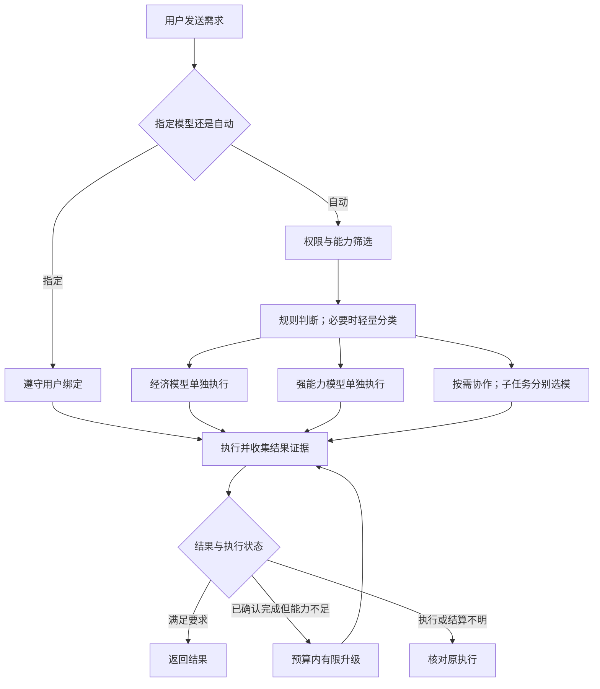

# 自动选模与按需协作

日期：2026-10-11。状态：调研和设计建议，尚未实现。作为[轻量协作方案](collaboration-lightweight-research.md)的补充，解决“小任务使用经济模型、复杂任务使用强能力模型”的需求。

用户已确认 Jev 可用可不用，并认可按角色分别选模的 ASCII 流程。具体插件边界、流程、开关/故障语义及首期范围以[可插拔决策插件设计](decision-plugins.md)为准；本文保留模型路由思想和上游调研依据。

## 1. 可行性与参考项目

这个方向可行。自动选择模型与多 Agent 分工应分别决策：简单任务可以只调用一个经济模型；复杂任务也可能只需要一个强模型；只有适合分工的任务才增加参与者。大任务中的资料整理、机械修改等局部工作仍可交给经济模型。

用户已确认所指为 TypeSafe AI 的 **Jev**。本方案采用其“应用状态 + 类型化问题 → 有界决策”的思想，将决策器作为独立、可替换的模块，Claude Code/Codex 继续承担推理、工具调用和代码执行。

| 参考 | 已核实的能力 | 对 agentbox 的启发与限制 |
| --- | --- | --- |
| [Jev](https://docs.typesafe.ai/introduction/coding-agents) | 决策模型，返回 Choice、Score 或 Noul；官方明确不写代码、不聊天、不调用工具，不能作为 Claude Code/Codex 的模型直接替换 | 可作为应用级分类/选择器，Go 服务根据结果调度；执行、权限和文件操作仍由 agentbox 掌握 |
| [Jev intent routing](https://docs.typesafe.ai/patterns/intent-routing) | 官方例子同时判断意图与复杂度，再由代码路由到对应处理者 | 可以合并意图和复杂度预测，避免分类本身变成多轮对话；分类结论仍需按项目任务评测 |
| [RouteLLM](https://github.com/lm-sys/RouteLLM) | 预测强模型相对弱模型的收益，按阈值选择其中一个执行 | 借鉴质量与成本权衡；核查版本只用最后一条消息且基于首轮数据训练，不适合直接拿“继续”判断整个代码任务；本身不是执行失败后的级联恢复 |
| [vLLM Semantic Router](https://github.com/vllm-project/semantic-router) | 提供难度信号、候选能力筛选、质量/成本/延迟选择 | 借鉴先筛候选、再做选择；难度分不等于正确率。它主要是推理 API 路由层，不是本项目 CLI 会话的替换运行时 |
| [NVIDIA ToolOrchestra](https://github.com/NVlabs/ToolOrchestra) | 训练较小的 orchestrator，按任务调用工具、专用模型或通用模型，同时优化结果、效率和偏好 | 支持“小决策器调度多种能力”的方向；属于不同于 Jev 的多轮工具编排研究，不能将基准收益照搬到仓库开发，也没有必要首版就引入模型托管/训练体系 |
| [RouterBench](https://github.com/withmartian/routerbench) | 比较请求前路由和请求后级联的质量/成本曲线，累计所有尝试成本 | 借鉴评估方法；其 cascade 评判使用预存成绩和模拟错误率，不能代替真实代码验证 |

Jev 官方当前模型说明是文本输入，英文表现最好，中文代码需求需要单独测试。其 RLCD 训练目标是校准决策概率，但校准是针对一组预测的统计性质，不保证单次答案正确；API 的 confidence 又是从概率分布计算出的单独指标，不能把 0.8 直接解释成 80% 正确。多跳问题、计算、选项顺序、无关长上下文等都有官方列出的局限。

首版建议先实现可解释规则和可替换的路由接口。需要学习型判断时，可以接 Jev 或其他分类器；不把某一家路由服务写死为系统必须依赖，也不默认把所有聊天全文发往新增服务。

### 1.1 Jev 接入边界

TypeSafe 官方接口为 `POST https://api.typesafe.ai/v1/systemone`，通过 `state` 提供任务状态，通过 `questions` 提交可并行判断的类型化问题。2026-10-11 核查时，`jev-latest` 指向 `jev-1.13.0`，官方价格为每百万输入 token 0.042 美元，输出免费；这只是决策调用费用，不包含后续 Agent 执行成本。

开发试验可用别名；正式评估、阈值校准和上线配置优先固定版本。持久决定记录请求的模型名、响应中的实际版本、问题定义版本及候选集合，服务重启或别名升级不会改写已接受任务的决定。

可将三个独立判断合并在一次请求里，而不额外启动一个“规划 Agent”：

| 类型 | 业务判断示例 | 应用如何使用 |
| --- | --- | --- |
| Choice | 更需要局部编辑、问题诊断，还是架构设计能力 | 按类别筛选已经获准的模型候选 |
| Score | 依据给定分档标准，这个任务有多复杂 | 与本项目校准的阈值比较，不能将序数分值直接当成功率 |
| Noul | 任务中是否存在值得分别委派的独立部分 | 作为是否分工的信号，实际委派仍由调度器和主 Agent 决定 |

应用根据这些结果、用户绑定、预算和模型能力生成最终路线。路由原因由命中的规则和结果字段生成可读说明，不要求 Jev 生成解释文字。输入优先取已持久化的目标、用户约束、已有摘要和文件元数据，不为了准备一次轻量判断再强制调用高级模型写摘要。

Jev 可以提供命令风险等语义信号；账号、目录边界、执行权限和生产操作授权仍由确定性代码核对，分类分数不能扩大执行资格。选择第三方网关时需单独验证类型化接口、概率字段和版本记录，不因提供同名模型就假定语义完全相同。

### 1.2 决策器可替换，私有化另选后端

决策模块统一接收任务状态和有限候选，返回类型化判断、分数来源及版本信息；选择模型和取得执行资格仍属于 Go 调度器。接口允许后端声明能力，不要求所有实现都假装支持 Jev 的完整 primitive 协议。

| 后端 | 用途 | 边界 |
| --- | --- | --- |
| 本地规则 | 明确任务的快速路径和服务不可用时的配置回退 | 无额外模型调用，但覆盖范围和优先级需要明确 |
| Jev 托管 API | 可选的语义分类、复杂度与分工判断 | 独立服务配置和费用；阈值跟随固定模型及问题版本验证 |
| [SemIf](https://github.com/TheoLeeCJ/SemIf-OpenJev) 类本地实现 | 自托管开放权重模型，从选项 logits 读取判断 | 需要本地模型与推理资源，结果需要单独校准，不继承 Jev 的训练或性能结论 |

SemIf 仓库明确标注“formerly OpenJev”，是独立研究项目。核查版本使用冻结的上游开放权重；它复现决策用法，不是 Jev 权重或 RLCD 训练的开源复现。

其 Python direct 路径执行一次 forward，读取最后位置的选项 logits 并 softmax，不调用 generate 或采样回答 token，但仍承担输入 prefill 的计算成本。浏览器 demo 则使用 `max_tokens:1` 读取 logprobs，不能把所有后端统称为零 token。主要接口是 2～16 项的选项判断，未核实到 Jev 原生 Choice/Score/Noul 全协议兼容。

SemIf 的原生选项分数明确为未校准；可用代表性任务做温度校准，但不能直接与 Jev confidence 共用一个阈值。后端、模型/量化、选项集合或问题定义变化后需要复评。支持 CPU、CUDA 或 Apple 的不同运行路径不代表时延相同，自托管是否划算要包含权重加载、常驻资源和实际请求量。

用户提供的官方及第三方效率倍数可用于了解决策模型的研究动机，不作为 agentbox 的性能指标。验收继续比较中文代码任务的完整成功率、费用与耗时。

## 2. 要做的三个决定

1. **用哪个模型**：在获准且适配当前任务的候选里，选择预期能完成要求的较低成本配置。
2. **用多大推理强度**：只在该账号和模型支持的档位内选择，不把 Claude/Codex 同名档位视为等价。
3. **是否需要其他 Agent**：根据可分解性、独立能力和预期收益决定，不把“复杂”直接等同于“多 Agent”。

模型配置首期只需经济档和强能力档两组，管理员可分别配置实际账号、模型和强度。档位表示经过评测的用途与成本，不根据品牌、参数量、型号名字或单价自行推断能力。

| 任务情况 | 默认建议 |
| --- | --- |
| 上下文明确的文案、格式、局部机械修改 | 经济模型单独完成 |
| 涉及鉴权、计费、迁移、并发，或定位原因不清楚 | 直接选择强能力候选，不必先让经济模型失败一次 |
| 多模块开发，能够分离设计、实施、研究或审查 | 主方处理关键决策，按子任务能力分别选助手 |
| 范围很大但模式明确的重复修改 | 可以经济模型实施，配合针对性的确定性检查；不能仅按文件数判为困难 |
| “继续”“按刚才的做”等短消息 | 依据已有任务目标和上下文，通常沿用已冻结的当前任务选择 |

短需求可能很难，大任务也可能包含容易的子任务。分类输入至少包含有效目标、必要上下文、已知操作范围和验证条件，不只计算文字长度。

## 3. 运行路径



上图表示待实现的策略，不改变当前生产的固定双角色流程。验证按任务需要进行，不要求每个简单请求再付费调用一个评审 Agent。

### 3.1 先过滤，再路由

用户明确指定的 CLI、账号、模型、分工和预算优先。自动选择仅限已配置且用户授权的候选范围，检查账号授权、模型 allowlist、任务所需能力、已知上下文限制、强度支持和剩余预算。分类器只能从服务端发给它的候选 ID 中选择，不能生成任意账号、模型名、命令或新增权限。

确定的规则直接出结果。模糊任务才调用轻量分类器；调用要有输入上限、超时和清晰的回退。分类失败或信息缺失不能默认判为简单；在原授权/预算内使用任务接收时冻结的预设回退，回退不再获准时说明无法执行。强档回退需要提前显式配置，不能无条件升级到最贵模型。

不要求每条消息先经过高级模型规划，也不默认同时向多个模型发送相同业务请求。模型路由通常在任务/子任务边界发生，同一执行中的任务不反复切换配置。

### 3.2 证据不足时怎样升级

升级针对“已确认的执行结果不足”，例如可复现的针对性测试失败、验收点未完成或已确认的连续无进展。区分网络、权限、缺依赖等环境问题；更贵的模型通常不能直接解决这些问题。

先确认旧回合进程停止、文件边界稳定、历史和费用收尾，再创建关联的升级步骤。新步骤继承已有工作副本、目标、变更摘要和失败证据，继续解决剩余问题。原执行处于 uncertain、响应丢失或费用未确认时，先核对原回合，不能把换模型当成整单重跑。

默认可先限制为一次自动能力升级，且必须在用户授权的自动候选和预算内；超过范围明确显示需要用户决定。已固定模型的任务不静默换模型。弱模型自报“我很有信心”不是验收，强模型一句“通过”也不能替代需要的测试。

“预算内”指按已结算费用和后续估价在步骤边界准入，分类调用计入同一任务预算；当前机制不能保证正在运行的回合最终绝不超额，未知价格不能按零放行。

升级使用父步骤、冻结结果/快照和路由策略版本形成稳定标识；同一事务核对修订号、领取执行资格、登记下一步骤并更新任务级升级次数。多调度器、刷新、轮询或重启不能重复创建升级；新子任务也不能重置总升级限额。升级只续做剩余工作，不重放已经发生的外部提交、部署或消息操作，文件快照不能证明这些外部动作未发生。

## 4. 如何融入当前产品

输入框继续保留“普通对话 / 协作”。在已有模型选择中加入 `自动（均衡）`，仍可固定具体模型；主方和搭档各自支持自动或固定。既有用户的固定选择不因升级被改写，经济/质量偏好及候选池放在展开设置中，不增加一个常驻“决策 Agent”面板。

自动选择后给一句可展开的说明，例如：“局部样式修改，使用快速模型”；升级时显示：“验证发现遗漏，已在原修改上交给强能力模型继续”。用户能查看实际 CLI、模型、强度和升级原因。

普通对话未来的自动选模优先限于当前 CLI 和账号允许范围，跨 CLI 应通过协作参与者完成。插件首期先接新协作自动意图；现有 chat v1 冻结具体模型，自动普通对话需要另行扩展持久协议。现有普通空间不能直接把 Claude 会话换成 Codex 会话，页面属于同一对话也不代表两种 provider 共享原生记忆。

## 5. 现有实现能复用什么

| 现有基础 | 需要补充的能力 |
| --- | --- |
| 账号授权、模型 allowlist、强度解析 | 有限的自动候选集合、任务能力元数据、经过评测的分档；账号未设 allowlist 不等于允许自动发现任意模型 |
| 模型默认值与 hidden 标记 | 单独的自动路由启用字段；hidden 仍只控制 UI 展示，不改成执行权限。候选池初始可从可见模型中配置；一次路由不修改空间默认模型 |
| 持久请求、配置版本和步骤绑定 | 每次任务/步骤接受时冻结 `route_decision`：策略版本、输入引用、候选版本、最终绑定、原因、价格依据及父级升级关系；恢复时读取原决定 |
| 现有 CLI 执行器与独立 home | 绑定按 CLI/账号/模型/强度整体记录；跨 CLI 或账号创建新参与者，通过受控材料衔接上下文，不能复制 provider 会话 ID |
| 用量、价格快照、整数费用和预算 | 路由自身用量归因、升级链累计、未知价格处理、账号报价估计与任务质量指标 |
| 单活动步骤与进程收尾 | 单容器额度下的交棒、父步骤正常收尾后子任务才获执行资格；沿用轻协作的单写者约束 |

当前协作运行时严格核对配置绑定，`configure` 会撤销参与者并重新准备规划。因此不能每次想换模型就调用现有 configure；需要在轻协作调度里设计不可变的步骤绑定与路由决策。旧任务按原协议继续，新行为走版本化输入和新迁移。

现有价格主要按 Agent/模型匹配，不足以比较不同账号或中转供应商的实际报价。增加路由估价不能悄悄修改原结算规则。未知价格不能当免费；订阅账号的内部记账费用、额度消耗和实际支付费用也要分开看。

代码依据：[模型配置](../../internal/config/config.go)、[账号模型规则](../../internal/config/account_models.go)、[价格快照](../../internal/config/pricing_catalog.go)、[强度解析](../../internal/agent/reasoning.go)、[协作运行参数校验](../../internal/server/collaboration_turn.go)、[重新配置](../../internal/store/collaboration_control.go)、[费用与预算](../../internal/store/collaboration_budget.go)。

## 6. 怎样判断是否值得做

比较完整任务成本，而不只看单次模型价格：

```text
自动策略成本 = 路由 + 首次执行 + 所有升级尝试 + 验证 + 上下文交接开销
```

复杂任务如果大概率升级，先调用经济模型可能更贵、更慢。模型切换还可能损失缓存和增加上下文重建。并行可以缩短等待，也可能增加总费用；这些取舍需要实际任务数据。

建议实施顺序：

1. **建立基线**：从现有用量和已确认任务结果提取耗时、费用、验证结果、人工返工和任务类型；增加只记录推荐的规则路由，不改变现有执行，不增加付费分类调用。历史日志不能单独证明未调用模型的反事实表现。
2. **开放有限自动选模**：候选池先两档；明确简单任务使用经济档，复杂或不确定任务使用获准强档；固定模型仍可用。先在单任务可靠执行上验证，不必等待任意并行能力。
3. **接入可替换的 Jev 类分类器**：在代表性的中文仓库任务上，与纯规则策略比较；把分类时间/费用和误判算入，达到质量门槛才采用。新增服务接入和真实付费评估单独配置与授权。
4. **加入证据驱动升级与子任务路由**：验证旧工作保留、停止边界、单槽容量、费用累计及刷新恢复，再与按需委派联动。

评估至少比较固定经济模型、固定强模型、自动路由三种策略的成功率、人工修复率、端到端耗时、总成本、误判后升级率和异常恢复次数。重点覆盖中文长上下文、“继续”、简单表述但高影响的修改、账号撤权、价格未知、预算耗尽和执行结果不明。

此次仅核对项目资料和本地实现，未调用模型、运行上游项目或测量收益，不承诺节约比例。

## 7. 来源与核查版本

- Jev：[官方模型页](https://docs.typesafe.ai/models)、[在编码 Agent 中使用](https://docs.typesafe.ai/introduction/coding-agents)、[意图与复杂度路由](https://docs.typesafe.ai/patterns/intent-routing)、[confidence 定义](https://docs.typesafe.ai/confidence)、[已知弱点](https://docs.typesafe.ai/model-jaggedness/jev-1.13)。动态网页，核查日期 2026-10-11。
- Jev System One：[概率校准、三种 primitive 与 API 边界](https://docs.typesafe.ai/concepts/system-one)。官方明确校准针对预测集合，不能保证单次判断正确。
- SemIf：`23cf1f39fc9534fe81437200959b6dfc7106e45a`，2026-09-23；[身份与运行方式](https://github.com/TheoLeeCJ/SemIf-OpenJev/blob/23cf1f39fc9534fe81437200959b6dfc7106e45a/README.md)、[direct logits](https://github.com/TheoLeeCJ/SemIf-OpenJev/blob/23cf1f39fc9534fe81437200959b6dfc7106e45a/src/semif_phase1/direct.py)、[方法与比较范围](https://github.com/TheoLeeCJ/SemIf-OpenJev/blob/23cf1f39fc9534fe81437200959b6dfc7106e45a/docs/METHOD.md)、[校准边界](https://github.com/TheoLeeCJ/SemIf-OpenJev/blob/23cf1f39fc9534fe81437200959b6dfc7106e45a/docs/CALIBRATION.md)、[浏览器一 token 路径](https://github.com/TheoLeeCJ/SemIf-OpenJev/blob/23cf1f39fc9534fe81437200959b6dfc7106e45a/webgpu-demo/worker.js#L135)。
- RouteLLM：`0b64fdafe049e596a3f5657c219329f24af24198`；[README](https://github.com/lm-sys/RouteLLM/blob/0b64fdafe049e596a3f5657c219329f24af24198/README.md)、[Controller](https://github.com/lm-sys/RouteLLM/blob/0b64fdafe049e596a3f5657c219329f24af24198/routellm/controller.py)。
- vLLM Semantic Router：`e08ac49a7e03bc80ed0b3e77d75f7db7ee22b62f`；[难度信号](https://github.com/vllm-project/semantic-router/blob/e08ac49a7e03bc80ed0b3e77d75f7db7ee22b62f/website/docs/tutorials/signal/learned/complexity.md)、[多因素选择](https://github.com/vllm-project/semantic-router/blob/e08ac49a7e03bc80ed0b3e77d75f7db7ee22b62f/website/docs/tutorials/algorithm/selection/multi-factor.md)、[Agent harness 边界](https://github.com/vllm-project/semantic-router/blob/e08ac49a7e03bc80ed0b3e77d75f7db7ee22b62f/website/docs/installation/agent-harness.md)、[System One cascade](https://github.com/vllm-project/semantic-router/blob/e08ac49a7e03bc80ed0b3e77d75f7db7ee22b62f/website/docs/tutorials/algorithm/native/cascade.md)。该 cascade 当前面向 choice/score/noul 判断，不等同于通用编程任务失败恢复。
- ToolOrchestra：`c1c0a4002be128b18accb267aac5ffdc26a28103`；[README](https://github.com/NVlabs/ToolOrchestra/blob/c1c0a4002be128b18accb267aac5ffdc26a28103/README.md)、[模型/工具编排评估代码](https://github.com/NVlabs/ToolOrchestra/blob/c1c0a4002be128b18accb267aac5ffdc26a28103/evaluation/eval_hle.py)。
- RouterBench：`cc67d1008bd8f3cf1e8040cc3ba4034d31b93c0c`；[README](https://github.com/withmartian/routerbench/blob/cc67d1008bd8f3cf1e8040cc3ba4034d31b93c0c/README.md)、[cascade 和模拟评判器](https://github.com/withmartian/routerbench/blob/cc67d1008bd8f3cf1e8040cc3ba4034d31b93c0c/routers/run_cascading_router.py)。
